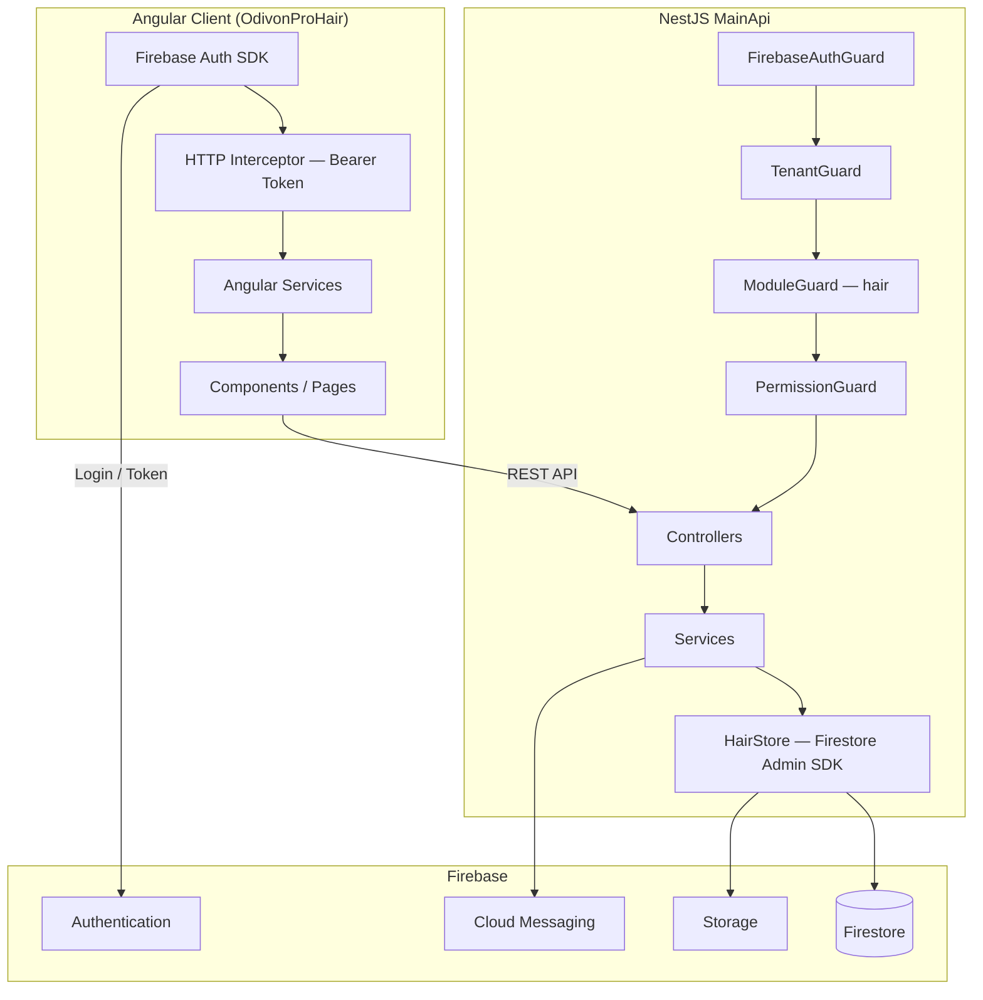
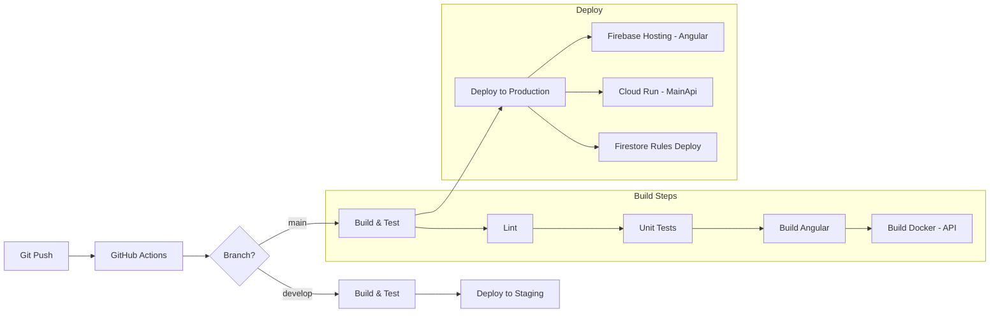

# 🏗️ OdivonPro Hair — Master Project Plan

> **Proje**: OdivonPro Kuaför Salon Yönetim Sistemi
> **Teknik ad**: `odivonprohair`
> **Tarih**: 2026-10-07
> **Durum**: Plan aşamasında — onay bekleniyor
> **Revizyon**: v2 — inceleme bulguları uygulandı (bkz. değişiklikler `[v2]` etiketiyle işaretli)

---

## 📋 İçindekiler

1. [Mimari Genel Bakış](#1-mimari-genel-bakış)
2. [Klasör Yapısı](#2-klasör-yapısı)
3. [Angular Modül / Component Yapısı](#3-angular-modül--component-yapısı)
4. [MainApi Endpoint Listesi](#4-mainapi-endpoint-listesi)
5. [Firestore Koleksiyon Şemaları](#5-firestore-koleksiyon-şemaları)
6. [Rol & Yetki Matrisi](#6-rol--yetki-matrisi)
7. [Ekran Listesi & Wireframe Tarifi](#7-ekran-listesi--wireframe-tarifi)
8. [İş Kuralları](#8-iş-kuralları)
9. [Firebase Security Rules](#9-firebase-security-rules)
10. [Örnek Angular Kod](#10-örnek-angular-kod)
11. [Örnek MainApi Kod](#11-örnek-mainapi-kod)
12. [Test Planı](#12-test-planı)
13. [Deployment Planı](#13-deployment-planı)
14. [Uygulama Fazları](#14-uygulama-fazları)

---

## 1. Mimari Genel Bakış



### Temel Kararlar

| Karar | Seçim | Gerekçe |
|-------|-------|---------|
| **Backend Framework** | NestJS + TypeScript | Mevcut MainApi ile uyum |
| **Tenant Yapısı** | 1 tenant = 1 işletme, N şube | `modules` array'ine `'hair'` eklenir |
| **Modül Adı** | `hair` | `PRODUCT_MODULES` → `['vet','farm','gym','spa','hair']` |
| **Guard Chain** | `FirebaseAuthGuard → TenantGuard → ModuleGuard → PermissionGuard` | Mevcut `SpaGuards` pattern'i |
| **Store Pattern** | `HairStore` (SpaStore klonu, `hair*` collection prefix) | Tenant-scoped, audit trail dahil |
| **Firestore Path** | `tenants/{tenantId}/hair*` | Ör: `tenants/abc/hairCustomers`, `tenants/abc/hairAppointments` |
| **Angular** | Standalone components, Signals, RxJS, TailwindCSS | Odivon Design System |
| **Müşteri Booking** | Aynı app, `/booking/:salonSlug` public layout | |
| **Diller** | tr (varsayılan), en | ngx-translate |
| **Bildirim Kanalları** | SMS, E-posta, WhatsApp, FCM Push, In-app | MainApi cron job |

---

## 2. Klasör Yapısı

### 2.1 MainApi — `src/modules/hair/`

```
src/modules/hair/
├── hair.module.ts                    # NestJS module registration
├── appointments/
│   ├── appointment.dto.ts
│   ├── hair-appointments.controller.ts
│   └── hair-appointments.service.ts
├── booking/                          # Public booking (no auth required)
│   ├── booking.dto.ts
│   ├── hair-booking.controller.ts
│   └── hair-booking.service.ts
├── catalog/
│   ├── catalog.dto.ts
│   ├── hair-catalog.controller.ts    # services, serviceCategories, products
│   └── hair-catalog.service.ts
├── core/
│   ├── core.dto.ts
│   ├── hair-core.controller.ts       # branches, settings, dashboard
│   ├── hair-core.service.ts
│   └── hair-onboarding.ts
├── customers/
│   ├── customer.dto.ts
│   ├── hair-customers.controller.ts
│   └── hair-customers.service.ts
├── finance/
│   ├── finance.dto.ts
│   ├── hair-finance.controller.ts    # payments, expenses, cashRegister, commissions
│   └── hair-finance.service.ts
├── formulas/
│   ├── formula.dto.ts
│   ├── hair-formulas.controller.ts   # saç formülleri, notlar, fotoğraflar
│   └── hair-formulas.service.ts
├── inventory/                        # [v2] stok hareketleri, low-stock (§4.8)
│   ├── inventory.dto.ts
│   ├── hair-inventory.controller.ts
│   └── hair-inventory.service.ts
├── notifications/
│   ├── notification.dto.ts
│   ├── hair-notifications.controller.ts
│   └── hair-notifications.service.ts
├── packages/
│   ├── package.dto.ts
│   ├── hair-packages.controller.ts
│   └── hair-packages.service.ts
├── pos/
│   ├── pos.dto.ts
│   ├── hair-pos.service.ts           # checkout pricing + stock deduction
│   └── hair-sessions.controller.ts
├── reports/
│   ├── report.dto.ts
│   ├── hair-reports.controller.ts
│   └── hair-reports.service.ts
├── shared/
│   ├── checkout-pricing.ts           # Pure pricing engine (unit testable)
│   ├── commission-engine.ts          # Commission resolution
│   ├── hair-errors.ts
│   ├── hair-guards.ts                # [FirebaseAuthGuard, TenantGuard, ModuleGuard, PermissionGuard]
│   ├── hair-list.dto.ts
│   ├── hair-money.ts                 # round2, PaymentLine
│   ├── hair-roles.ts                 # Roller, izinler, [v2] HAIR_ROLE_SCOPES (own/limited)
│   ├── branch-scope.guard.ts         # [v2] şube kapsamı doğrulaması
│   ├── hair-store.ts                 # Tenant-scoped Firestore store
│   ├── hair-time.ts                  # Timezone helpers
│   └── hair-collections.ts           # Collection name constants
├── staff/
│   ├── staff.dto.ts
│   ├── hair-staff.controller.ts
│   └── hair-staff.service.ts
└── waitlist/
    ├── waitlist.dto.ts
    ├── hair-waitlist.controller.ts
    └── hair-waitlist.service.ts
```

### 2.2 Angular Client — `C:\Users\dogan\Documents\Private\Project\OdivonProHair`

```
OdivonProHair/
├── angular.json
├── package.json
├── tailwind.config.js
├── tsconfig.json
├── src/
│   ├── index.html
│   ├── main.ts
│   ├── styles.scss
│   ├── environments/
│   │   ├── environment.ts
│   │   └── environment.prod.ts
│   ├── assets/
│   │   ├── i18n/
│   │   │   ├── tr.json
│   │   │   └── en.json
│   │   ├── icons/
│   │   └── images/
│   └── app/
│       ├── app.component.ts
│       ├── app.config.ts
│       ├── app.routes.ts
│       ├── core/
│       │   ├── auth/
│       │   │   ├── auth.service.ts               # Firebase Auth wrapper
│       │   │   ├── auth.guard.ts                  # CanActivate
│       │   │   ├── role.guard.ts
│       │   │   ├── login.component.ts             # [v2] route'ta kullanılıyordu, ağaçta eksikti
│       │   │   └── auth.interceptor.ts            # Bearer token injection (yalnızca kendi API'miz)
│       │   ├── services/
│       │   │   ├── api.service.ts                 # Base HTTP client
│       │   │   ├── tenant.service.ts
│       │   │   └── notification.service.ts
│       │   ├── models/
│       │   │   ├── customer.model.ts
│       │   │   ├── appointment.model.ts
│       │   │   ├── service.model.ts
│       │   │   ├── staff.model.ts
│       │   │   ├── payment.model.ts
│       │   │   ├── product.model.ts
│       │   │   ├── formula.model.ts
│       │   │   ├── commission.model.ts
│       │   │   └── ...
│       │   └── utils/
│       │       ├── date.utils.ts
│       │       ├── currency.pipe.ts
│       │       └── form-validation.ts
│       ├── shared/
│       │   ├── components/
│       │   │   ├── drawer/
│       │   │   │   └── slide-over-drawer.component.ts
│       │   │   ├── kpi-card/
│       │   │   │   └── kpi-card.component.ts
│       │   │   ├── data-table/
│       │   │   │   └── data-table.component.ts
│       │   │   ├── search-toolbar/
│       │   │   │   └── search-toolbar.component.ts
│       │   │   ├── status-badge/
│       │   │   │   └── status-badge.component.ts
│       │   │   ├── confirm-dialog/
│       │   │   │   └── confirm-dialog.component.ts
│       │   │   └── empty-state/
│       │   │       └── empty-state.component.ts
│       │   ├── layouts/
│       │   │   ├── admin-layout/
│       │   │   │   ├── admin-layout.component.ts
│       │   │   │   ├── sidebar.component.ts
│       │   │   │   └── topbar.component.ts
│       │   │   └── public-layout/
│       │   │       └── public-layout.component.ts
│       │   └── pipes/
│       │       └── translate-role.pipe.ts
│       └── features/
│           ├── dashboard/
│           │   └── dashboard.component.ts
│           ├── appointments/
│           │   ├── appointment-calendar.component.ts  # FullCalendar entegrasyonu
│           │   ├── appointment-drawer.component.ts
│           │   └── appointments.service.ts
│           ├── customers/
│           │   ├── customer-list.component.ts
│           │   ├── customer-detail.component.ts
│           │   ├── customer-drawer.component.ts
│           │   ├── customer-formulas.component.ts
│           │   └── customers.service.ts
│           ├── staff/
│           │   ├── staff-list.component.ts
│           │   ├── staff-drawer.component.ts
│           │   ├── staff-schedule.component.ts
│           │   └── staff.service.ts
│           ├── catalog/
│           │   ├── services/
│           │   │   ├── service-list.component.ts
│           │   │   └── service-drawer.component.ts
│           │   ├── categories/
│           │   │   └── category-list.component.ts
│           │   └── catalog.service.ts
│           ├── pos/
│           │   ├── pos-checkout.component.ts
│           │   ├── session-history.component.ts
│           │   └── pos.service.ts
│           ├── finance/
│           │   ├── payments/
│           │   │   └── payment-list.component.ts
│           │   ├── expenses/
│           │   │   └── expense-list.component.ts
│           │   ├── cash-register/
│           │   │   └── cash-register.component.ts
│           │   ├── commissions/
│           │   │   └── commission-list.component.ts
│           │   └── finance.service.ts
│           ├── inventory/
│           │   ├── product-list.component.ts
│           │   ├── product-drawer.component.ts
│           │   ├── stock-movements.component.ts
│           │   └── inventory.service.ts
│           ├── packages/
│           │   ├── package-plans.component.ts
│           │   ├── customer-packages.component.ts
│           │   └── packages.service.ts
│           ├── reports/
│           │   ├── daily-report.component.ts
│           │   ├── revenue-report.component.ts
│           │   ├── staff-performance.component.ts
│           │   └── reports.service.ts
│           ├── settings/
│           │   ├── general-settings.component.ts
│           │   ├── branch-settings.component.ts
│           │   ├── notification-settings.component.ts
│           │   ├── role-management.component.ts
│           │   └── settings.service.ts
│           ├── notifications/
│           │   └── notification-center.component.ts
│           └── booking/                            # Public — müşteri randevu
│               ├── booking-page.component.ts
│               ├── booking-confirmation.component.ts
│               └── booking.service.ts
```

---

## 3. Angular Modül / Component Yapısı

### Routing Yapısı

> **[v2]** Aşağıdaki `import('./x.component')` çağrıları, component'ler **named export** olduğu için
> `.then(m => m.XComponent)` ile (veya `export default class`) yazılmalıdır. Örnekler okunabilirlik için
> kısaltılmıştır; kodlamada her satır `import('...').then(m => m.<ComponentAdı>)` biçiminde olacak.
> `login.component.ts` → `core/auth/login.component.ts` olarak klasör ağacına eklendi.

```typescript
// app.routes.ts
export const APP_ROUTES: Routes = [
  // ── Public Booking ──
  {
    path: 'booking/:salonSlug',
    component: PublicLayoutComponent,
    children: [
      { path: '', loadComponent: () => import('./features/booking/booking-page.component') },
      { path: 'confirm', loadComponent: () => import('./features/booking/booking-confirmation.component') },
    ],
  },

  // ── Auth ──
  { path: 'login', loadComponent: () => import('./core/auth/login.component') },

  // ── Admin Panel ──
  {
    path: '',
    component: AdminLayoutComponent,
    canActivate: [authGuard],
    children: [
      { path: '', redirectTo: 'dashboard', pathMatch: 'full' },
      { path: 'dashboard',      loadComponent: () => import('./features/dashboard/dashboard.component') },
      { path: 'appointments',   loadComponent: () => import('./features/appointments/appointment-calendar.component') },
      { path: 'customers',      loadComponent: () => import('./features/customers/customer-list.component') },
      { path: 'customers/:id',  loadComponent: () => import('./features/customers/customer-detail.component') },
      { path: 'staff',          loadComponent: () => import('./features/staff/staff-list.component') },
      { path: 'catalog',        loadComponent: () => import('./features/catalog/services/service-list.component') },
      { path: 'pos',            loadComponent: () => import('./features/pos/pos-checkout.component') },
      { path: 'inventory',      loadComponent: () => import('./features/inventory/product-list.component') },
      { path: 'finance',        children: [
        { path: 'payments',     loadComponent: () => import('./features/finance/payments/payment-list.component') },
        { path: 'expenses',     loadComponent: () => import('./features/finance/expenses/expense-list.component') },
        { path: 'cash-register',loadComponent: () => import('./features/finance/cash-register/cash-register.component') },
        { path: 'commissions',  loadComponent: () => import('./features/finance/commissions/commission-list.component') },
      ]},
      { path: 'packages',       loadComponent: () => import('./features/packages/package-plans.component') },
      { path: 'reports',        children: [
        { path: 'daily',        loadComponent: () => import('./features/reports/daily-report.component') },
        { path: 'revenue',      loadComponent: () => import('./features/reports/revenue-report.component') },
        { path: 'staff',        loadComponent: () => import('./features/reports/staff-performance.component') },
      ]},
      { path: 'settings',       loadComponent: () => import('./features/settings/general-settings.component') },
    ],
  },

  { path: '**', redirectTo: '' },
];
```

### Component Mimarisi

| Pattern | Kullanım |
|---------|----------|
| **Standalone Components** | Tüm componentler `standalone: true` |
| **Signals** | `signal()`, `computed()`, `toSignal()` — subscribe yerine |
| **Lazy Loading** | Her feature route `loadComponent` ile lazy |
| **Drawer Pattern** | Tüm CRUD create/edit işlemleri slide-over drawer ile |
| **KPI Cards** | Dashboard 4'lü grid executive card layout |
| **Data Table** | Shared component: search, sort, pagination, empty state |

---

## 4. MainApi Endpoint Listesi

> Tüm admin endpoint'ler prefix: `/api/hair/...`
> Public booking prefix: `/api/hair/public/booking/...`
> Guard chain: `@UseGuards(...HairGuards)` + `@RequireModule('hair')`

### 4.1 Core & Branches

| Method | Path | Permission | Açıklama |
|--------|------|-----------|----------|
| `GET` | `/hair/dashboard` | `hairDashboard:view` | KPI verileri |
| `GET` | `/hair/settings` | `hairSettings:view` | Salon ayarları |
| `PATCH` | `/hair/settings` | `hairSettings:update` | Ayar güncelle |
| `GET` | `/hair/branches` | `hairBranches:view` | Şube listesi |
| `POST` | `/hair/branches` | `hairBranches:create` | Şube oluştur |
| `PATCH` | `/hair/branches/:id` | `hairBranches:update` | Şube güncelle |
| `DELETE` | `/hair/branches/:id` | `hairBranches:delete` | Şube sil (soft) |
| `POST` | `/hair/onboarding` | owner only | İlk kurulum |

### 4.2 Customers

| Method | Path | Permission | Açıklama |
|--------|------|-----------|----------|
| `GET` | `/hair/customers` | `hairCustomers:view` | Müşteri listesi (search, filter) |
| `GET` | `/hair/customers/:id` | `hairCustomers:view` | Müşteri detay |
| `POST` | `/hair/customers` | `hairCustomers:create` | Yeni müşteri |
| `PATCH` | `/hair/customers/:id` | `hairCustomers:update` | Müşteri güncelle |
| `DELETE` | `/hair/customers/:id` | `hairCustomers:delete` | Müşteri sil (soft) |
| `GET` | `/hair/customers/:id/history` | `hairCustomers:view` | Randevu ve ödeme geçmişi |
| `GET` | `/hair/customers/:id/formulas` | `hairFormulas:view` | Saç formülleri |
| `POST` | `/hair/customers/:id/formulas` | `hairFormulas:create` | Formül kaydet |
| `PATCH` | `/hair/customers/:id/formulas/:fid` | `hairFormulas:update` | Formül güncelle |
| `POST` | `/hair/customers/:id/media` | `hairFormulas:create` | Fotoğraf yükle |

### 4.3 Catalog (Services & Products)

| Method | Path | Permission | Açıklama |
|--------|------|-----------|----------|
| `GET` | `/hair/service-categories` | `hairCatalog:view` | Kategori listesi |
| `POST` | `/hair/service-categories` | `hairCatalog:create` | Kategori oluştur |
| `PATCH` | `/hair/service-categories/:id` | `hairCatalog:update` | Kategori güncelle |
| `DELETE` | `/hair/service-categories/:id` | `hairCatalog:delete` | Kategori sil |
| `GET` | `/hair/services` | `hairCatalog:view` | Hizmet listesi |
| `POST` | `/hair/services` | `hairCatalog:create` | Hizmet oluştur |
| `PATCH` | `/hair/services/:id` | `hairCatalog:update` | Hizmet güncelle |
| `DELETE` | `/hair/services/:id` | `hairCatalog:delete` | Hizmet sil |
| `GET` | `/hair/products` | `hairStock:view` | Ürün listesi |
| `POST` | `/hair/products` | `hairStock:create` | Ürün oluştur |
| `PATCH` | `/hair/products/:id` | `hairStock:update` | Ürün güncelle |
| `DELETE` | `/hair/products/:id` | `hairStock:delete` | Ürün sil |

### 4.4 Appointments

| Method | Path | Permission | Açıklama |
|--------|------|-----------|----------|
| `GET` | `/hair/appointments` | `hairAppointments:view` | Randevu listesi (from, to, staffId, branchId) |
| `GET` | `/hair/appointments/:id` | `hairAppointments:view` | Randevu detay |
| `POST` | `/hair/appointments` | `hairAppointments:create` | Randevu oluştur (çakışma kontrolü) |
| `PATCH` | `/hair/appointments/:id` | `hairAppointments:update` | Randevu güncelle |
| `PATCH` | `/hair/appointments/:id/status` | `hairAppointments:update` | Durum değiştir (confirmed/checkedIn/completed/cancelled/noShow) |
| `DELETE` | `/hair/appointments/:id` | `hairAppointments:delete` | Randevu iptal |

### 4.5 Staff

| Method | Path | Permission | Açıklama |
|--------|------|-----------|----------|
| `GET` | `/hair/staff` | `hairStaff:view` | Personel listesi |
| `POST` | `/hair/staff` | `hairStaff:create` | Personel ekle |
| `PATCH` | `/hair/staff/:id` | `hairStaff:update` | Personel güncelle |
| `DELETE` | `/hair/staff/:id` | `hairStaff:delete` | Personel sil |
| `GET` | `/hair/staff/:id/schedule` | `hairStaff:view` | Çalışma takvimi |
| `GET` | `/hair/shifts` | `hairStaff:view` | Vardiya listesi |
| `POST` | `/hair/shifts` | `hairStaff:create` | Vardiya oluştur |
| `GET` | `/hair/time-off` | `hairLeaves:view` | İzin listesi |
| `POST` | `/hair/time-off` | `hairLeaves:create` | İzin talebi |
| `PATCH` | `/hair/time-off/:id` | `hairLeaves:update` | İzin onayla/reddet |

### 4.6 POS & Payments

| Method | Path | Permission | Açıklama |
|--------|------|-----------|----------|
| `POST` | `/hair/pos/checkout` | `hairSessions:create` | Kasa çıkış (ödeme + stok + komisyon) |
| `GET` | `/hair/sessions` | `hairSessions:view` | İşlem geçmişi |
| `GET` | `/hair/sessions/:id` | `hairSessions:view` | İşlem detay |
| `GET` | `/hair/payments` | `hairPayments:view` | Ödeme listesi |
| `POST` | `/hair/payments` | `hairPayments:create` | Manuel ödeme |
| `GET` | `/hair/expenses` | `hairExpenses:view` | Gider listesi |
| `POST` | `/hair/expenses` | `hairExpenses:create` | Gider ekle |

### 4.7 Finance & Cash Register

| Method | Path | Permission | Açıklama |
|--------|------|-----------|----------|
| `GET` | `/hair/cash-register/today` | `hairCashRegister:view` | Gün sonu kasa |
| `POST` | `/hair/cash-register/open` | `hairCashRegister:create` | Kasa aç |
| `POST` | `/hair/cash-register/close` | `hairCashRegister:create` | Kasa kapat |
| `GET` | `/hair/commissions` | `hairCommissions:view` | Komisyon listesi |
| `POST` | `/hair/commissions/rules` | `hairCommissions:create` | Komisyon kuralı ekle |
| `PATCH` | `/hair/commissions/rules/:id` | `hairCommissions:update` | Kural güncelle |

### 4.8 Inventory & Stock

| Method | Path | Permission | Açıklama |
|--------|------|-----------|----------|
| `GET` | `/hair/inventory/transactions` | `hairStock:view` | Stok hareketleri |
| `POST` | `/hair/inventory/transactions` | `hairStock:create` | Manuel stok giriş/çıkış |
| `GET` | `/hair/inventory/low-stock` | `hairStock:view` | Düşük stok uyarısı |

### 4.9 Packages & Memberships

| Method | Path | Permission | Açıklama |
|--------|------|-----------|----------|
| `GET` | `/hair/packages` | `hairPackages:view` | Paket planları |
| `POST` | `/hair/packages` | `hairPackages:create` | Paket oluştur |
| `PATCH` | `/hair/packages/:id` | `hairPackages:update` | Paket güncelle |
| `GET` | `/hair/customer-packages` | `hairPackages:view` | Müşteri paketleri |
| `POST` | `/hair/customer-packages` | `hairPackages:create` | Müşteriye paket sat |

### 4.10 Reports

| Method | Path | Permission | Açıklama |
|--------|------|-----------|----------|
| `GET` | `/hair/reports/daily` | `hairReports:view` | Günlük rapor |
| `GET` | `/hair/reports/revenue` | `hairReports:view` | Ciro raporu (tarih aralığı) |
| `GET` | `/hair/reports/staff-performance` | `hairReports:view` | Personel performans |
| `GET` | `/hair/reports/inventory` | `hairReports:view` | Stok raporu |
| `GET` | `/hair/reports/customer-retention` | `hairReports:view` | Müşteri geri kazanım |

### 4.11 Notifications

| Method | Path | Permission | Açıklama |
|--------|------|-----------|----------|
| `GET` | `/hair/notifications` | any staff | Bildirim listesi |
| `PATCH` | `/hair/notifications/:id/read` | any staff | Okundu işaretle |
| `POST` | `/hair/notifications/send` | `hairSettings:update` | Manuel bildirim gönder |

### 4.12 Waitlist

| Method | Path | Permission | Açıklama |
|--------|------|-----------|----------|
| `GET` | `/hair/waitlist` | `hairAppointments:view` | Bekleme listesi |
| `POST` | `/hair/waitlist` | `hairAppointments:create` | Listeye ekle |
| `DELETE` | `/hair/waitlist/:id` | `hairAppointments:delete` | Listeden çıkar |

### 4.13 Public Booking (Auth gerektirmez — salonSlug ile erişim)

| Method | Path | Permission | Açıklama |
|--------|------|-----------|----------|
| `GET` | `/hair/public/booking/:slug/info` | — | Salon bilgileri |
| `GET` | `/hair/public/booking/:slug/services` | — | Hizmet listesi |
| `GET` | `/hair/public/booking/:slug/staff` | — | Uygun personeller |
| `GET` | `/hair/public/booking/:slug/slots` | — | Boş randevu slotları (tarih + hizmet + personel) |
| `POST` | `/hair/public/booking/:slug/appointments` | — | Online randevu al |
| `GET` | `/hair/public/booking/:slug/appointments/:id` | — | Randevu durumu |
| `PATCH` | `/hair/public/booking/:slug/appointments/:id/cancel` | — | Randevu iptal (OTP/link ile) |

#### [v2] Public Booking Güvenlik Gereksinimleri

- **Tenant çözümü**: `:slug` = **şube slug'ı** (`hairBranches.slug`). Slug → `collectionGroup('hairBranches').where('slug','==',slug)` ile tenant+şube bulunur; slug global unique olmalı (onboarding'de kontrol). Ayrı bir `publicSlugs/{slug} → {tenantId, branchId}` indeks dokümanı tercih edilir (collectionGroup yerine, hızlı ve kural dışı).
- **Rate limit**: IP başına ve telefon başına (`@nestjs/throttler`); randevu oluşturmada ek olarak aynı telefondan günlük max N bekleyen randevu.
- **Bot koruması**: `POST …/appointments` ve OTP isteğinde reCAPTCHA Enterprise / Turnstile token zorunlu.
- **Telefon doğrulama (OTP)**: randevu onayı ve iptal için SMS OTP; doğrulanmamış talep 15 dk sonra düşer.
- **Randevu erişimi**: `:id` tahmin edilemez olmalı (≥128 bit rastgele `publicToken`); `GET/PATCH …/appointments/:id?token=…` yalnızca token ile çalışır. Response'ta tam telefon/e-posta yerine maskeli veri döner.
- **Slot rezervasyonu**: bkz. R-001 (transaction içinde çakışma kontrolü).
- **İptal penceresi**: yalnızca `cancellationHoursBefore` öncesi (R-009).

### 4.13b [v2] Eksik Endpoint'ler

| Method | Path | Permission | Açıklama |
|--------|------|-----------|----------|
| `POST` | `/hair/staff/:id/invite` | `hairStaff:create` | Personeli e-posta ile davet et, Auth UID bağla |
| `POST` | `/hair/sessions/:id/refund` | `hairSessions:update` | Tam/kısmi iade (stok, paket, komisyon ve müşteri istatistiği ters kayıt) |
| `PATCH` | `/hair/expenses/:id` · `DELETE` | `hairExpenses:update/delete` | Gider düzelt/sil |
| `PATCH` | `/hair/shifts/:id` · `DELETE` | `hairStaff:update/delete` | Vardiya düzenle/sil |
| `GET` | `/hair/time-off/:id` | `hairLeaves:view` | İzin detay |
| `POST` | `/hair/commissions/payout` | `hairCommissions:create` | Seçili komisyonları ödenmiş işaretle |
| `GET` | `/hair/customers/:id/media` | `hairFormulas:view` | Fotoğraf listesi (imzalı URL, kısa ömürlü) |
| `POST` | `/hair/customers/:id/merge` | `hairCustomers:update` | Mükerrer müşteri birleştirme |
| `POST` | `/hair/cash-register/count` | `hairCashRegister:create` | Fiziksel sayım girişi (K-004) |

**Genel liste sözleşmesi**: tüm `GET` listeler `?limit=` (varsayılan 50, max 200) ve `?cursor=` (Firestore `startAfter`) destekler; yanıt `{ items, nextCursor }`.
Soft-delete: tüm listeler `deletedAt == null` filtreler → bkz. `firestore.indexes.json` listesi (§5.14).

### 4.14 Audit Logs

| Method | Path | Permission | Açıklama |
|--------|------|-----------|----------|
| `GET` | `/hair/audit-logs` | `hairAudit:view` | İşlem logları |

---

## 5. Firestore Koleksiyon Şemaları

### Firestore Path Convention

```
tenants/{tenantId}/hairBranches/{branchId}
tenants/{tenantId}/hairCustomers/{customerId}
tenants/{tenantId}/hairServiceCategories/{categoryId}
tenants/{tenantId}/hairServices/{serviceId}
tenants/{tenantId}/hairAppointments/{appointmentId}
tenants/{tenantId}/hairAppointmentServices/{appointmentServiceId}
tenants/{tenantId}/hairStaff/{staffId}
tenants/{tenantId}/hairShifts/{shiftId}
tenants/{tenantId}/hairTimeOff/{timeOffId}
tenants/{tenantId}/hairPayments/{paymentId}
tenants/{tenantId}/hairExpenses/{expenseId}
tenants/{tenantId}/hairProducts/{productId}
tenants/{tenantId}/hairInventoryTransactions/{txId}
tenants/{tenantId}/hairPackages/{packageId}
tenants/{tenantId}/hairCustomerPackages/{customerPackageId}
tenants/{tenantId}/hairCommissions/{commissionId}
tenants/{tenantId}/hairCommissionRules/{ruleId}
tenants/{tenantId}/hairFormulas/{formulaId}
tenants/{tenantId}/hairMedia/{mediaId}
tenants/{tenantId}/hairSessions/{sessionId}
tenants/{tenantId}/hairCashRegister/{registerId}
tenants/{tenantId}/hairNotifications/{notificationId}
tenants/{tenantId}/hairWaitlist/{waitlistId}
tenants/{tenantId}/hairReviews/{reviewId}
tenants/{tenantId}/hairSettings/{tenantId}   ← singleton
tenants/{tenantId}/hairAuditLogs/{logId}
```

### 5.1 hairBranches

```typescript
interface HairBranchDoc {
  id: string;
  name: string;                    // "Merkez Şube"
  slug: string;                    // "merkez-sube" — public booking URL'de kullanılır
  address: string;
  phone: string;
  email?: string;
  workDayStart: string;            // "09:00"
  workDayEnd: string;              // "21:00"
  workDays: number[];              // [1,2,3,4,5,6] — 0=Pazar
  slotDurationMinutes: number;     // 15 (takvim slot büyüklüğü)
  active: boolean;
  createdAt: string;
  createdBy: string;
  updatedAt: string;
  updatedBy: string;
  deletedAt?: string | null;
}
```

**Örnek Doküman:**
```json
{
  "id": "branch-001",
  "name": "OdivonPro Hair Kadıköy",
  "slug": "odivonpro-hair-kadikoy",
  "address": "Caferağa Mah. Moda Cad. No:12 Kadıköy/İstanbul",
  "phone": "+905551234567",
  "email": "kadikoy@odivonprohair.com",
  "workDayStart": "09:00",
  "workDayEnd": "21:00",
  "workDays": [1, 2, 3, 4, 5, 6],
  "slotDurationMinutes": 15,
  "active": true,
  "createdAt": "2026-10-07T00:00:00Z",
  "createdBy": "uid-owner",
  "updatedAt": "2026-10-07T00:00:00Z",
  "updatedBy": "uid-owner"
}
```

### 5.2 hairCustomers

```typescript
interface HairCustomerDoc {
  id: string;
  firstName: string;
  lastName: string;
  phone: string;                   // E.164. [v2] Unique per tenant: Firestore'da constraint yok →
                                   // tenants/{t}/hairCustomerPhones/{phone} → customerId dokümanı
                                   // aynı transaction'da oluşturulur (varsa 409).
  email?: string;
  noShowCount: number;             // [v2] R-010
  allergies?: string;              // [v2] alerji / hassasiyet notu (boya, kimyasal)
  lastPatchTestDate?: string;      // [v2] son yama testi tarihi
  consentCommercialIys?: boolean;  // [v2] İYS onayı (ticari ileti: doğum günü, geri kazanım)
  consentPhotos?: boolean;         // [v2] fotoğraf çekimi/saklama rızası (KVKK)
  gender?: 'male' | 'female' | 'other';
  birthDate?: string;              // "1990-05-15"
  notes?: string;
  tags?: string[];                 // ["VIP", "Düzenli"]
  preferredStaffId?: string;
  preferredBranchId?: string;
  source: 'walk-in' | 'online' | 'referral' | 'phone';
  totalVisits: number;
  totalSpent: number;
  lastVisitDate?: string;
  membershipId?: string;
  consentSms: boolean;
  consentEmail: boolean;
  consentWhatsapp: boolean;
  photoUrl?: string;
  active: boolean;
  createdAt: string;
  createdBy: string;
  updatedAt: string;
  updatedBy: string;
  deletedAt?: string | null;
}
```

### 5.3 hairServiceCategories

```typescript
interface HairServiceCategoryDoc {
  id: string;
  name: string;                    // "Saç Kesimi", "Boyama", "Bakım"
  icon?: string;
  sortOrder: number;
  active: boolean;
  createdAt: string;
  createdBy: string;
  updatedAt: string;
  updatedBy: string;
  deletedAt?: string | null;
}
```

### 5.4 hairServices

```typescript
interface HairServiceDoc {
  id: string;
  categoryId: string;
  name: string;                    // "Erkek Saç Kesimi"
  description?: string;
  durationMinutes: number;         // 30
  price: number;                   // 350.00
  gender?: 'male' | 'female' | 'unisex';
  requiresFormula: boolean;        // Boya hizmetleri için true
  processingMinutes?: number;      // [v2] bekleme/işlem süresi (durationMinutes içinde; R-012)
  depositAmount?: number;          // [v2] opsiyonel kapora (R-016)
  vatRate?: number;                // [v2] KDV oranı (ör. 20)
  productsUsed?: {                 // Otomatik stok düşümü için
    productId: string;
    quantity: number;
  }[];
  branchIds?: string[];            // Boş = tüm şubeler
  staffIds?: string[];             // Boş = tüm personel yapabilir
  onlineBookable: boolean;         // Online randevuda gösterilsin mi
  sortOrder: number;
  active: boolean;
  createdAt: string;
  createdBy: string;
  updatedAt: string;
  updatedBy: string;
  deletedAt?: string | null;
}
```

### 5.5 hairAppointments

```typescript
type AppointmentStatus =
  | 'pending'      // Online'dan geldi, onay bekliyor
  | 'confirmed'    // Onaylandı
  | 'checkedIn'    // Müşteri geldi
  | 'inProgress'   // İşlem başladı
  | 'completed'    // Tamamlandı
  | 'cancelled'    // İptal
  | 'noShow';      // Gelmedi

interface HairAppointmentDoc {
  id: string;
  customerId: string;
  customerName: string;            // Denormalized for calendar display
  customerPhone: string;
  branchId: string;
  staffId: string;                 // [v2] birincil personel (R-013)
  staffName: string;               // Denormalized
  staffColor?: string;             // [v2] takvim rengi (hairStaff.color'dan denormalize)
  date: string;                    // "2026-10-08" — şubenin timezone'unda yerel tarih
  startTime: string;               // "14:00" — yerel saat
  endTime: string;                 // "15:30"
  startAt: string;                 // [v2] UTC ISO — sorgu/sıralama için (date+startTime+tz'den türetilir)
  endAt: string;                   // [v2] UTC ISO
  totalDurationMinutes: number;
  status: AppointmentStatus;
  source: 'walk-in' | 'online' | 'phone' | 'receptionist';
  publicToken?: string;            // [v2] online randevu erişim/iptal tokenı (hash saklanır)
  depositAmount?: number;          // [v2]
  services: {
    serviceId: string;
    serviceName: string;
    staffId: string;               // [v2] satır bazında personel (R-013)
    startOffsetMinutes: number;    // [v2] randevu başlangıcına göre
    durationMinutes: number;
    processingMinutes?: number;    // [v2] R-012
    price: number;
  }[];
  totalPrice: number;
  notes?: string;
  checkedInAt?: string;
  completedAt?: string;
  cancelledAt?: string;
  cancelReason?: string;
  reminderSent?: boolean;
  sessionId?: string;              // POS session sonrası link
  createdAt: string;
  createdBy: string;
  updatedAt: string;
  updatedBy: string;
  deletedAt?: string | null;
}
```

### 5.6 hairStaff

```typescript
interface HairStaffDoc {
  id: string;                      // [v2] otomatik id (hesapsız personel de eklenebilsin)
  userId?: string;                 // [v2] Firebase Auth UID — davet kabul edilince bağlanır
  inviteStatus?: 'none' | 'invited' | 'accepted'; // [v2] POST /hair/staff/:id/invite
  firstName: string;
  lastName: string;
  phone: string;
  email: string;
  role: HairStaffRole;             // 'admin' | 'manager' | 'receptionist' | 'stylist' | 'cashier'
  branchIds: string[];             // Çalıştığı şubeler
  specialties?: string[];          // ["Saç Kesimi", "Ombre", "Keratin"]
  serviceIds?: string[];           // Yapabildiği hizmetler
  photoUrl?: string;
  defaultCommissionPercent: number; // 30
  workSchedule: {
    dayOfWeek: number;             // 0-6
    startTime: string;             // "09:00"
    endTime: string;               // "18:00"
  }[];
  hireDate: string;
  active: boolean;
  onlineBookable: boolean;         // Online randevuda gösterilsin mi
  color?: string;                  // Takvimde renk kodu "#6366f1"
  createdAt: string;
  createdBy: string;
  updatedAt: string;
  updatedBy: string;
  deletedAt?: string | null;
}
```

### 5.7 hairPayments

```typescript
interface HairPaymentDoc {
  id: string;
  sessionId: string;
  appointmentId?: string;
  customerId: string;
  customerName: string;
  branchId: string;
  staffId: string;
  lines: PaymentLine[];
  totalAmount: number;
  date: string;
  notes?: string;
  createdAt: string;
  createdBy: string;
  updatedAt: string;
  updatedBy: string;
  deletedAt?: string | null;
}

interface PaymentLine {
  method: 'cash' | 'creditCard' | 'debitCard' | 'bankTransfer' | 'other';
  amount: number;
  reference?: string;              // Kart son 4 hane, dekont no vb.
}
```

### 5.8 hairProducts

```typescript
interface HairProductDoc {
  id: string;
  name: string;                    // "L'Oreal Majirel 6.0"
  category: string;                // "Boya", "Şampuan", "Bakım"
  brand?: string;
  barcode?: string;
  unit: string;                    // "adet", "ml", "gr"
  purchasePrice: number;
  salePrice: number;
  currentStock: number;
  minStock: number;                // Düşük stok uyarısı eşiği
  branchId?: string;               // Boş = genel depo
  supplierId?: string;
  active: boolean;
  createdAt: string;
  createdBy: string;
  updatedAt: string;
  updatedBy: string;
  deletedAt?: string | null;
}
```

### 5.9 hairFormulas

```typescript
interface HairFormulaDoc {
  id: string;
  customerId: string;
  staffId: string;
  staffName: string;
  date: string;
  title: string;                   // "Ombre Formülü — Ekim 2026"
  formula: string;                 // "6/0 + 7/1 oksidan %20 30dk"
  products: {
    productId: string;
    productName: string;
    quantity: string;              // "50ml"
  }[];
  notes?: string;
  mediaIds?: string[];             // Fotoğraf referansları
  appointmentId?: string;
  createdAt: string;
  createdBy: string;
  updatedAt: string;
  updatedBy: string;
  deletedAt?: string | null;
}
```

### 5.10 hairSessions (POS İşlemleri)

```typescript
interface HairSessionDoc {
  id: string;
  appointmentId?: string;
  customerId: string;
  customerName: string;
  branchId: string;
  staffId: string;
  staffName: string;
  items: ResolvedSessionItem[];
  totalAmount: number;
  globalDiscount: number;
  payments: PaymentLine[];
  commissions: { staffId: string; staffName: string; amount: number }[];
  productDecrements: { productId: string; productName: string; qty: number }[];
  packageDecrements: { packageId: string; qty: number }[];
  date: string;
  idempotencyKey: string;          // [v2] istemci üretir; aynı key ikinci kez gelirse mevcut session döner
  vatTotal?: number;               // [v2] KDV toplamı
  invoiceRef?: string;             // [v2] e-Arşiv/e-Fatura referansı (entegrasyon sonrası)
  refunds?: { refundId: string; amount: number; reason: string; at: string; by: string }[]; // [v2]
  status: 'completed' | 'refunded' | 'partialRefund';
  createdAt: string;
  createdBy: string;
  updatedAt: string;
  updatedBy: string;
}
```

### 5.11 hairCommissionRules

```typescript
interface HairCommissionRuleDoc {
  id: string;
  scope: 'staff' | 'serviceCategory' | 'service';
  refId: string;                   // staffId veya serviceId veya categoryId
  type: 'percent' | 'fixed';
  value: number;
  priority: number;                // Düşük = yüksek öncelik
  active: boolean;
  createdAt: string;
  createdBy: string;
  updatedAt: string;
  updatedBy: string;
  deletedAt?: string | null;
}
```

### 5.11b hairCommissions [v2 — şema eksikti]

```typescript
interface HairCommissionDoc {
  id: string;
  sessionId: string;
  staffId: string;
  staffName: string;
  serviceId?: string;
  basisAmount: number;             // C-006
  ruleId?: string;                 // eşleşen kural (yoksa null → staff default)
  amount: number;                  // negatif olabilir (iade ters kaydı)
  date: string;
  payoutStatus: 'unpaid' | 'paid'; // PATCH /hair/commissions/payout
  payoutId?: string;
  reversalOf?: string;             // iade durumunda orijinal komisyon id
  createdAt: string;
  createdBy: string;
}
```

### 5.11c Yardımcı Koleksiyonlar [v2]

| Koleksiyon | Amaç |
|-----------|------|
| `hairCustomerPhones/{e164}` | Telefon unique garantisi → `{customerId}` (transaction ile) |
| `hairStaffDayLocks/{staffId_date}` | Randevu çakışma serileştirmesi (R-011) |
| `hairIdempotency/{key}` | Checkout/randevu tekrar isteklerini tekilleştirme (TTL 24 saat) |
| `publicSlugs/{slug}` (root) | `{tenantId, branchId}` — public booking çözümü |
| `hairCommissionPayouts/{id}` | Komisyon ödeme (toplu `paid` işaretleme) kaydı |

### 5.12 hairSettings (Singleton)

```typescript
interface HairSettingsDoc {
  id: string;                      // = tenantId
  timezone: string;                // "Europe/Istanbul"
  currency: string;                // "TRY"
  workDayStart: string;
  workDayEnd: string;
  onlineBookingEnabled: boolean;
  autoConfirmOnlineBooking: boolean;
  reminderHoursBefore: number;     // 24
  noShowPolicy: string;
  cancellationHoursBefore: number; // 2
  smsProvider?: 'netgsm' | 'twilio' | 'iletiMerkezi';
  // [v2] API anahtarları BU dokümanda tutulmaz (tüm roller hairSettings:view okur).
  // Anahtarlar Secret Manager'da: projects/*/secrets/hair-{tenantId}-sms, hair-{tenantId}-email.
  // Burada yalnızca durum bilgisi: smsConfigured / emailConfigured (boolean, maskeli).
  smsConfigured: boolean;
  emailConfigured: boolean;
  whatsappEnabled: boolean;
  emailProvider?: 'sendgrid' | 'nodemailer';
  birthdayMessageEnabled: boolean;
  reengagementDays: number;        // 30 gün sonra hatırlatma
  logoUrl?: string;
  primaryColor?: string;
  createdAt: string;
  createdBy: string;
  updatedAt: string;
  updatedBy: string;
}
```

### 5.13 Diğer Koleksiyonlar (Kısa)

| Koleksiyon | Temel Alanlar |
|-----------|---------------|
| `hairInventoryTransactions` | `productId, type(in/out/adjustment), quantity, reason, branchId, date` |
| `hairPackages` | `name, services[], totalSessions, price, validityDays, active` |
| `hairCustomerPackages` | `customerId, packageId, remainingSessions, status, startDate, endDate` |
| `hairShifts` | `staffId, branchId, date, startTime, endTime` |
| `hairTimeOff` | `staffId, startDate, endDate, type(annual/sick/unpaid), status(pending/approved/rejected), reason` |
| `hairExpenses` | `category, description, amount, paymentMethod, date, branchId, receiptUrl` |
| `hairCashRegister` | `branchId, date, openingBalance, closingBalance, status(open/closed), openedBy, closedBy` |
| `hairNotifications` | `recipientId, type, title, body, channel(sms/email/push/whatsapp/in-app), status(pending/sent/failed), sentAt` |
| `hairWaitlist` | `customerId, customerName, serviceIds, preferredDate, preferredStaffId, branchId, status(waiting/notified/booked)` |
| `hairReviews` | `customerId, appointmentId, staffId, rating(1-5), comment, date` |
| `hairMedia` | `customerId, url, type(photo/video), description, uploadedBy, appointmentId` |
| `hairAuditLogs` | `entity, action, entityId, before, after, userId, userEmail, createdAt` |

### 5.14 [v2] Firestore Composite Index Listesi (`firestore.indexes.json`)

| Koleksiyon | Alanlar |
|-----------|---------|
| `hairAppointments` | `deletedAt ↑, branchId ↑, startAt ↑` · `staffId ↑, startAt ↑` · `customerId ↑, startAt ↓` |
| `hairCustomers` | `deletedAt ↑, lastName ↑` · `deletedAt ↑, lastVisitDate ↓` |
| `hairPayments` | `branchId ↑, date ↓` · `customerId ↑, date ↓` |
| `hairSessions` | `branchId ↑, date ↓` · `staffId ↑, date ↓` |
| `hairCommissions` | `staffId ↑, payoutStatus ↑, date ↓` |
| `hairInventoryTransactions` | `productId ↑, date ↓` |
| `hairNotifications` | `recipientId ↑, status ↑, createdAt ↓` |

---

## 6. Rol & Yetki Matrisi

### 6.1 Staff Rolleri

```typescript
const HAIR_STAFF_ROLES = ['admin', 'manager', 'receptionist', 'stylist', 'cashier'] as const;
type HairStaffRole = (typeof HAIR_STAFF_ROLES)[number];
```

### 6.2 Yetki Matrisi

| Resource Key | Admin | Manager | Receptionist | Stylist | Cashier |
|-------------|-------|---------|-------------|---------|---------|
| `hairCustomers` | VCUD | VCUD | VCU | V | V |
| `hairAppointments` | VCUD | VCUD | VCU | V(own) | V |
| `hairCatalog` | VCUD | VCU | V | V | V |
| `hairStock` | VCUD | VCUD | VCU | V | V |
| `hairStaff` | VCUD | VCU | V | V(own) | V |
| `hairLeaves` | VCUD | VCU | VC | VC(own) | VC(own) |
| `hairPackages` | VCUD | VCU | VCU | V | V |
| `hairSessions` | VCUD | VCU | VC | VC | VC |
| `hairPayments` | VCUD | VCU | VCU | V | VCU |
| `hairExpenses` | VCUD | VCU | VC | — | VC |
| `hairCashRegister` | VCUD | VCU | VC | V | VC |
| `hairCommissions` | VCUD | V | — | V(own) | V |
| `hairFormulas` | VCUD | VCU | V | VCU | — |
| `hairSettings` | VCUD | V | V | V | V |
| `hairReports` | V | V | V(limited) | V(own) | V(limited) |
| `hairBranches` | VCUD | VU | V | V | V |
| `hairDashboard` | V | V | V | V(own) | V |
| `hairAudit` | V | V | — | — | — |

> **V** = view, **C** = create, **U** = update, **D** = delete
> **(own)** = yalnızca kendi kayıtları

### 6.2b [v2] Kapsam Kuralları (Matrisin Uygulanması)

- **`(own)` kapsamı** artık uygulanır: `PermissionGuard` yetkiyi verdikten sonra servis katmanı `scope` değerini
  (`'all' | 'own' | 'limited'`) `HairRequestContext` içinde alır. `own` → sorgu `staffId == ctx.staffId` ile
  filtrelenir (randevu, komisyon, izin, dashboard, rapor). `limited` → tutar/maliyet alanları response'tan çıkarılır.
  Rol → scope tablosu `hair-roles.ts` içinde `HAIR_ROLE_SCOPES` olarak tutulur (matristeki (own)/(limited) hücreleri).
- **Şube kapsamı**: `admin` ve `owner` tüm şubeleri görür; diğer roller yalnızca `staff.branchIds` içindeki
  şubeleri. `BranchScopeGuard` (PermissionGuard'dan sonra) `branchId` query/body değerini doğrular ve
  listelerde `branchId in ctx.branchIds` filtresi uygular.
- **`owner`**: tenant sahibi, `users/{uid}.tenantRole = 'owner'` ile belirlenir (staff rolü DEĞİL); admin
  yetkilerinin tamamına ek olarak onboarding ve tenant silme/devri yapabilir.
- **Roller sabittir** (5 rol). Ayarlar → "Rol Yönetimi" ekranı yalnızca personele rol atama ekranıdır;
  özel rol oluşturma kapsam dışı (ileride `hairRoles` koleksiyonu ile genişletilebilir).
- **Stilist** randevu/müşteri listesinde yalnızca kendi randevuları ve ilgili müşterileri görür;
  online-bookable personel listesi public endpoint'ten gelir, panelden değil.

### 6.3 Customer Rolü (Public Booking)

Müşteriler Firebase Auth ile giriş yapmadan sadece public booking endpoint'lerini kullanır. Opsiyonel olarak telefon doğrulama ile kendi randevularını görebilir.

---

## 7. Ekran Listesi & Wireframe Tarifi

### 7.1 Admin Panel Ekranları

| # | Ekran | Route | Wireframe Tarifi |
|---|-------|-------|-----------------|
| 1 | **Dashboard** | `/dashboard` | 4'lü KPI grid (Günlük ciro, Randevu sayısı, Müşteri sayısı, Bekleyen randevu). Altında ciro grafiği (Chart.js line), personel performans bar chart, son 5 randevu listesi |
| 2 | **Randevu Takvimi** | `/appointments` | FullCalendar — haftalık/günlük/aylık görünüm. Personel bazlı renkli eventler. Tıklayınca sağdan drawer açılır. Üstte personel/şube filtresi |
| 3 | **Randevu Drawer** | (drawer) | Müşteri seçimi (arama), hizmet seçimi (multi), personel seçimi, tarih/saat picker, not alanı, süre otomatik hesaplama |
| 4 | **Müşteri Listesi** | `/customers` | Odivon CRUD list pattern: search bar, tablo (ad, telefon, son ziyaret, toplam harcama, durum badge). Tıklayınca detay |
| 5 | **Müşteri Detay** | `/customers/:id` | Tab layout: Bilgiler, Randevu Geçmişi, Formüller, Ödeme Geçmişi, Paketler, Fotoğraflar. Üstte müşteri kartı (avatar, iletişim, VIP badge) |
| 6 | **Saç Formülü Drawer** | (drawer) | Formül metin alanı, kullanılan ürünler (dropdown + miktar), fotoğraf yükleme, not |
| 7 | **Personel Listesi** | `/staff` | Kart grid veya tablo: foto, ad, rol badge, şube, uzmanlık. Tıklayınca edit drawer |
| 8 | **Personel Çalışma Takvimi** | `/staff/:id/schedule` | Haftalık grid: vardiyalar, izinler, randevular birleşik görünüm |
| 9 | **Hizmet Kataloğu** | `/catalog` | Kategori accordion + hizmet listesi. Drawer ile CRUD |
| 10 | **POS / Kasa** | `/pos` | Tam ekran checkout: Sol panel (müşteri seçimi, hizmet/ürün ekleme, randevu bağlama), Sağ panel (sepet, indirim, ödeme yöntemleri — parçalı ödeme) |
| 11 | **Stok Yönetimi** | `/inventory` | Ürün listesi + stok durumu renk kodlu badge (yeşil/sarı/kırmızı). Stok hareket geçmişi tab'ı |
| 12 | **Ödeme Listesi** | `/finance/payments` | Tarih filtreli tablo: tarih, müşteri, tutar, ödeme yöntemi, personel |
| 13 | **Gider Listesi** | `/finance/expenses` | Kategori filtreli gider tablosu + drawer ile ekleme |
| 14 | **Kasa** | `/finance/cash-register` | Gün sonu özeti: açılış, nakit giriş/çıkış, kart toplamı, kapanış. Kasa aç/kapat butonları |
| 15 | **Komisyon Tablosu** | `/finance/commissions` | Personel bazlı komisyon özeti, tarih filtresi, kurallar alt tab'ı |
| 16 | **Paket Yönetimi** | `/packages` | Paket planları tablosu + müşteriye satılmış paketler |
| 17 | **Günlük Rapor** | `/reports/daily` | Tarih seçimi, ciro/gider/net kâr KPI kartları, ödeme yöntemi dağılımı pie chart |
| 18 | **Ciro Raporu** | `/reports/revenue` | Tarih aralığı, ciro trend line chart, kategori bazlı bar chart |
| 19 | **Personel Performans** | `/reports/staff` | Personel bazlı randevu/ciro/komisyon karşılaştırma bar chart |
| 20 | **Ayarlar** | `/settings` | Tab layout: Genel, Şubeler, Bildirimler, Rol Yönetimi |
| 21 | **Bildirim Merkezi** | sidebar bell icon | Dropdown veya slide-over: son bildirimler, okunmamış sayacı |

### 7.2 Public Booking Ekranları

| # | Ekran | Route | Wireframe Tarifi |
|---|-------|-------|-----------------|
| 22 | **Booking Page** | `/booking/:slug` | Step wizard: 1) Hizmet seç, 2) Personel seç (opsiyonel), 3) Tarih/saat seç (boş slotlar), 4) İletişim bilgileri, 5) Onay |
| 23 | **Booking Confirmation** | `/booking/:slug/confirm` | Özet kartı: seçilen hizmetler, personel, tarih/saat, toplam tutar. Randevu durumu badge |

---

## 8. İş Kuralları

### 8.1 Randevu Kuralları

```
R-001: Aynı personel için aynı zaman diliminde başka randevu olamaz (çakışma kontrolü)
R-002: Çakışma kontrolü: yeni randevunun [startTime, endTime) aralığı mevcut herhangi bir
       aktif randevunun aralığıyla kesişmemeli
R-003: Randevu süresi = seçilen hizmetlerin durationMinutes toplamı
R-004: Randevu sadece personelin çalışma saatleri içinde ve izinsiz günlerde alınabilir
R-005: Randevu sadece şubenin çalışma saatleri ve günleri içinde alınabilir
R-006: Online randevu → durum 'pending', salon onayı ile 'confirmed' olur
       (autoConfirmOnlineBooking = true ise direkt 'confirmed')
R-007: Resepsiyondan alınan randevu → direkt 'confirmed'
R-008: Durumu 'completed' veya 'cancelled' olan randevu tekrar düzenlenemez
R-009: İptal süresi: cancellationHoursBefore saat öncesine kadar müşteri iptal edebilir
R-010: noShow → müşteriye noShow sayacı artırılır (customer.noShowCount)
R-011 [v2]: R-001 çakışma kontrolü ve randevu yazımı AYNI Firestore transaction içinde yapılır.
       Transaction'da (staffId, date) sorgusu okunur, çakışma yoksa yazılır. Gerekirse
       tenants/{t}/hairStaffDayLocks/{staffId_date} dokümanı ile serileştirilir.
R-012 [v2]: Hizmetin `processingMinutes` alanı (bekleme/işlem süresi — ör. boya bekleme) olabilir.
       Bu aralıkta personel başka randevuya atanabilir; çakışma kontrolü `activeMinutes` bloklarına bakar.
R-013 [v2]: Bir randevu birden fazla personel içerebilir (her `services[]` satırında `staffId`).
       Randevu seviyesindeki `staffId` birincil personeldir; çakışma kontrolü satır bazında yapılır.
R-014 [v2]: İptal tek yoldan yapılır: `PATCH /status {status:'cancelled', reason}`.
       `DELETE /appointments/:id` yalnızca hatalı kayıtlar için soft-delete (admin) olarak kalır.
R-015 [v2]: Personel/yönetici iptali her zaman serbesttir; R-009 yalnızca müşteri (public) iptali içindir.
R-016 [v2]: Opsiyonel kapora: hizmette `depositAmount` varsa online randevu 'pending' kalır ve
       ödeme/onay sonrası 'confirmed' olur. noShow'da kapora iade edilmez (settings.noShowPolicy).
```

### 8.2 Ödeme Kuralları

```
P-001: Ödeme tutarlarının toplamı = session toplam tutarı (EPSILON toleransı ±0.01)
P-002: Parçalı ödeme: birden fazla PaymentLine (ör. 200₺ nakit + 150₺ kart)
P-003: Paket seansı kullanıldığında o hizmetin tutarı toplama eklenmez
P-004: İndirim satır tutarını aşamaz
P-005: Genel indirim toplam tutarı aşamaz
P-006: Ödeme sonrası appointment.status = 'completed' ve sessionId bağlanır
```

### 8.3 Komisyon Kuralları

```
C-001: Komisyon öncelik sırası: service-specific > serviceCategory-specific > staff-default
C-002: Aynı scope'ta birden fazla kural varsa priority değeri düşük olan kazanır
C-003: Kural tipi 'percent' ise → (value/100) × basisAmount
C-004: Kural tipi 'fixed' ise → value (sabit tutar)
C-005: Hiçbir kural eşleşmezse → staff.defaultCommissionPercent kullanılır
C-006: basisAmount = hizmetin indirimsiz fiyatı × adet (indirimden önce hesaplanır)
C-007: Komisyon sadece hizmetlerden hesaplanır, ürün satışından komisyon yok
       (opsiyonel: ürün komisyonu settings'ten açılabilir)
```

### 8.4 Stok Düşümü Kuralları

```
S-001: Checkout sırasında satılan ürünlerin stokları otomatik düşülür
S-002: Hizmetle ilişkili ürünler (service.productsUsed) checkout'ta otomatik düşülür
S-003: Stok yetersizse checkout başarısız olur (precondition hatası)
S-004: Her stok hareketi hairInventoryTransactions'a yazılır (audit trail)
S-005: currentStock ≤ minStock olduğunda düşük stok uyarısı oluşturulur
S-006: Manuel stok giriş/çıkış/düzeltme yapılabilir (reason zorunlu)
```

### 8.5 Kasa Kuralları

```
K-001: Gün başında kasa açılır (openingBalance girilir)
K-002: Gün sonunda kasa kapatılır, sistem kapanış bakiyesini hesaplar
K-003: Hesaplanan kapanış = openingBalance + nakit girişler - nakit çıkışlar - nakit giderler
K-004: Gerçek kapanış (fiziksel sayım) ile hesaplanan arasındaki fark raporlanır
K-005: Kasa kapalıyken nakit işlem yapılamaz (uyarı verilir)
```

### 8.6 Bildirim Kuralları

```
N-001: Randevu hatırlatma: reminderHoursBefore saat önce SMS/WhatsApp/E-posta
N-002: Doğum günü mesajı: müşterinin doğum gününde otomatik (birthdayMessageEnabled)
N-003: Geri kazanım: reengagementDays gün boyunca gelmemiş müşterilere mesaj
N-004: Online randevu alındığında salona push notification
N-005: Randevu onay/iptal durumunda müşteriye bildirim
N-006 [v2]: Doğum günü ve geri kazanım mesajları TİCARİ ileti sayılır → yalnızca
       consentCommercialIys = true olan müşterilere gönderilir (İYS uyumu). Randevu hatırlatma/onay
       mesajları işlemsel iletidir, İYS onayı gerektirmez.
N-007 [v2]: Zamanlanmış işler (hatırlatma, doğum günü, geri kazanım) Cloud Run içinde setInterval/cron ile
       DEĞİL, Cloud Scheduler → korumalı HTTP endpoint (OIDC) ile tetiklenir (scale-to-zero uyumu).
       Her iş idempotent olmalı (reminderSent bayrağı + hairNotifications kontrolü).
N-008 [v2]: Müşterilerin Auth hesabı olmadığından FCM push yalnızca personele gider; müşteriye SMS/WhatsApp/e-posta.
```

### 8.7 [v2] Vergi, Fatura ve Uyum

```
V-001: Her hizmet/ürün satırında vatRate bulunur; session.vatTotal checkout'ta hesaplanır.
       Fiyatlar KDV dahil tutulur (hair-money.ts içinde extractVat/addVat yardımcıları).
V-002: e-Arşiv/e-Fatura entegrasyonu MVP dışıdır; session.invoiceRef alanı hazır bırakılır.
V-003: İade (refund): session.status güncellenir, ters hairInventoryTransactions, ters
       hairCommissions (reversalOf), paket seansı iadesi ve customer.totalSpent düşümü TEK transaction'da yapılır.
V-004: KVKK: müşteri silme isteğinde kişisel veri anonimleştirilir (ad/telefon/e-posta/foto silinir,
       finansal kayıtlar anonim müşteri id'siyle kalır). Fotoğraflar consentPhotos = true olmadan yüklenemez.
       Pasif müşteri verisi için saklama süresi settings'te tanımlanır (varsayılan 5 yıl).
V-005: Storage: müşteri fotoğrafları yalnızca API üzerinden yazılır/okunur (Admin SDK);
       storage.rules tümüyle `allow read, write: if false`; erişim kısa ömürlü imzalı URL ile.
```

---

## 9. Firebase Security Rules

```javascript
// Firestore Security Rules
rules_version = '2';
service cloud.firestore {
  match /databases/{database}/documents {

    // ─── TÜM CLIENT ERİŞİMİ KAPALI ───
    // Tüm veri işlemleri MainApi (Firebase Admin SDK) üzerinden yapılır.
    // Admin SDK, security rules'u bypass eder.
    // Bu kurallar yalnızca doğrudan client erişimini engellemek içindir.

    // Global deny-all
    match /{document=**} {
      allow read, write: if false;
    }

    // Tenant-scoped koleksiyonlar — client erişimi yok
    match /tenants/{tenantId}/{collection}/{docId} {
      allow read, write: if false;
    }

    // Users koleksiyonu — client erişimi yok
    match /users/{userId} {
      allow read, write: if false;
    }
  }
}
```

> [!IMPORTANT]
> **Güvenlik tamamen MainApi'de sağlanır:**
> - `FirebaseAuthGuard` → Token doğrulama
> - `TenantGuard` → Kullanıcının bu tenant'a erişim hakkı var mı
> - `ModuleGuard` → Tenant'ın `modules` array'inde `'hair'` var mı
> - `PermissionGuard` → Staff'ın ilgili permission'ı var mı
>
> Admin SDK, Firestore Security Rules'u bypass eder.
> Client tarafı doğrudan Firestore'a yazamaz.

---

## 10. Örnek Angular Kod

### 10.1 Auth Interceptor

```typescript
// src/app/core/auth/auth.interceptor.ts
import { HttpInterceptorFn } from '@angular/common/http';
import { inject } from '@angular/core';
import { AuthService } from './auth.service';
import { environment } from '../../../environments/environment';
import { filter, firstValueFrom, from, switchMap, take } from 'rxjs';

// [v2] Token yalnızca kendi API'mize eklenir; public booking uçlarına eklenmez.
// [v2] Sayfa yenilenince currentUser() henüz null olabilir → auth hazır olana kadar beklenir.
export const authInterceptor: HttpInterceptorFn = (req, next) => {
  const isOwnApi = req.url.startsWith(environment.apiUrl);
  const isPublic = req.url.includes('/hair/public/');
  if (!isOwnApi || isPublic) return next(req);

  const auth = inject(AuthService);
  return auth.authReady$.pipe(           // authReady$: onAuthStateChanged ilk emit'ten sonra true
    filter(Boolean),
    take(1),
    switchMap(() => {
      const user = auth.currentUser();
      if (!user) return next(req);
      return from(user.getIdToken()).pipe(
        switchMap((token) =>
          next(req.clone({ setHeaders: { Authorization: `Bearer ${token}` } })),
        ),
      );
    }),
  );
};
```

### 10.2 Appointments Service

```typescript
// src/app/features/appointments/appointments.service.ts
import { HttpClient } from '@angular/common/http';
import { inject, Injectable, signal } from '@angular/core';
import { finalize } from 'rxjs';
import { environment } from '../../../environments/environment';
import { Appointment, SaveAppointmentDto } from '../../core/models/appointment.model';

@Injectable({ providedIn: 'root' })
export class AppointmentsService {
  private readonly http = inject(HttpClient);
  private readonly baseUrl = `${environment.apiUrl}/hair/appointments`;

  readonly loading = signal(false);

  list(from: string, to: string, staffId?: string, branchId?: string) {
    this.loading.set(true);
    const params: Record<string, string> = { from, to };
    if (staffId) params['staffId'] = staffId;
    if (branchId) params['branchId'] = branchId;

    // [v2] from/to = UTC ISO (startAt aralığı, [from, to)); finalize hata durumunda da loading'i kapatır
    return this.http.get<Appointment[]>(this.baseUrl, { params }).pipe(
      finalize(() => this.loading.set(false)),
    );
  }

  get(id: string) {
    return this.http.get<Appointment>(`${this.baseUrl}/${id}`);
  }

  create(dto: SaveAppointmentDto) {
    return this.http.post<Appointment>(this.baseUrl, dto);
  }

  update(id: string, dto: SaveAppointmentDto) {
    return this.http.patch<Appointment>(`${this.baseUrl}/${id}`, dto);
  }

  setStatus(id: string, status: string, reason?: string) {
    return this.http.patch<Appointment>(`${this.baseUrl}/${id}/status`, { status, reason });
  }

  delete(id: string) {
    return this.http.delete(`${this.baseUrl}/${id}`);
  }
}
```

### 10.3 Appointment Calendar Component

```typescript
// src/app/features/appointments/appointment-calendar.component.ts
import { Component, inject, signal, computed, OnInit, viewChild } from '@angular/core';
import { CommonModule } from '@angular/common';
import { FullCalendarModule } from '@fullcalendar/angular';
import { CalendarOptions, DatesSetArg, EventClickArg } from '@fullcalendar/core';
import trLocale from '@fullcalendar/core/locales/tr';   // [v2] locale: 'tr' için gerekli
import { EventDropArg } from '@fullcalendar/core';
import dayGridPlugin from '@fullcalendar/daygrid';
import timeGridPlugin from '@fullcalendar/timegrid';
import interactionPlugin from '@fullcalendar/interaction';
import { TranslateModule, TranslateService } from '@ngx-translate/core';
import { AppointmentsService } from './appointments.service';
import { StaffService } from '../staff/staff.service';
import { AppointmentDrawerComponent } from './appointment-drawer.component';

@Component({
  selector: 'app-appointment-calendar',
  standalone: true,
  imports: [CommonModule, FullCalendarModule, TranslateModule, AppointmentDrawerComponent],
  template: `
    <div class="space-y-6">
      <!-- Page Header -->
      <div class="flex flex-col sm:flex-row sm:items-center justify-between gap-4">
        <div>
          <h1 class="text-2xl sm:text-3xl font-black text-slate-900 dark:text-white tracking-tight">
            {{ 'appointments.title' | translate }}
          </h1>
          <p class="text-xs sm:text-sm font-medium text-slate-500 dark:text-slate-400 mt-1">
            {{ 'appointments.subtitle' | translate }}
          </p>
        </div>
        <div class="flex items-center gap-3">
          <!-- Staff Filter -->
          <select
            [value]="selectedStaffId()"
            (change)="onStaffFilter($event)"
            class="px-3 py-2.5 rounded-xl text-xs sm:text-sm bg-slate-50 dark:bg-slate-800/60 border border-slate-200 dark:border-slate-700 text-slate-900 dark:text-white focus:outline-none focus:ring-2 focus:ring-indigo-500/30"
          >
            <option value="">{{ 'appointments.allStaff' | translate }}</option>
            @for (staff of staffList(); track staff.id) {
              <option [value]="staff.id">{{ staff.firstName }} {{ staff.lastName }}</option>
            }
          </select>

          <button
            type="button"
            (click)="openDrawer()"
            class="px-5 py-2.5 rounded-xl bg-gradient-to-r from-indigo-500 to-purple-600 hover:from-indigo-600 hover:to-purple-700 text-white text-xs sm:text-sm font-bold shadow-lg shadow-indigo-500/25 flex items-center gap-2 transition-all hover:scale-[1.02] active:scale-[0.98] cursor-pointer"
          >
            <span>+ {{ 'appointments.new' | translate }}</span>
          </button>
        </div>
      </div>

      <!-- Calendar -->
      <div class="bg-white dark:bg-slate-900 rounded-2xl border border-slate-200/80 dark:border-slate-800 shadow-sm p-4">
        <full-calendar [options]="calendarOptions()" />
      </div>
    </div>

    <!-- Appointment Drawer -->
    <app-appointment-drawer
      [isOpen]="isDrawerOpen()"
      [appointment]="selectedAppointment()"
      (closed)="closeDrawer()"
      (saved)="onAppointmentSaved()"
    />
  `,
})
export class AppointmentCalendarComponent implements OnInit {
  private readonly appointmentsService = inject(AppointmentsService);
  private readonly staffService = inject(StaffService);

  readonly staffList = signal<any[]>([]);
  readonly selectedStaffId = signal('');
  readonly isDrawerOpen = signal(false);
  readonly selectedAppointment = signal<any>(null);
  readonly events = signal<any[]>([]);

  readonly calendarOptions = computed<CalendarOptions>(() => ({
    plugins: [dayGridPlugin, timeGridPlugin, interactionPlugin],
    initialView: 'timeGridWeek',
    locale: trLocale,
    firstDay: 1,                                 // [v2] Pazartesi; yükleme aralığı da buna göre
    datesSet: (arg: DatesSetArg) => this.onDatesSet(arg),   // [v2] gezinince yeni aralığı yükle
    eventDrop: (arg: EventDropArg) => this.onEventDrop(arg), // [v2] editable için handler (çakışma 409 → revert)
    headerToolbar: {
      left: 'prev,next today',
      center: 'title',
      right: 'dayGridMonth,timeGridWeek,timeGridDay',
    },
    slotMinTime: '08:00:00',
    slotMaxTime: '22:00:00',
    slotDuration: '00:15:00',
    events: this.events(),
    eventClick: (info: EventClickArg) => this.onEventClick(info),
    dateClick: (info: any) => this.onDateClick(info),
    editable: true,
    selectable: true,
    nowIndicator: true,
    allDaySlot: false,
    height: 'auto',
  }));

  private range = signal<{ from: string; to: string } | null>(null);

  ngOnInit() {
    this.loadStaff();
    // [v2] ilk yükleme datesSet ile tetiklenir
  }

  private loadStaff() {
    this.staffService.list().subscribe((staff) => this.staffList.set(staff));
  }

  onDatesSet(arg: DatesSetArg) {
    // arg.start/end görünür aralık (end exclusive) → UTC ISO olarak API'ye gider
    this.range.set({ from: arg.start.toISOString(), to: arg.end.toISOString() });
    this.loadAppointments();
  }

  onEventDrop(arg: EventDropArg) {
    const apt = arg.event.extendedProps['appointment'];
    this.appointmentsService
      .update(apt.id, { ...apt, date: arg.event.startStr.slice(0, 10), startTime: arg.event.startStr.slice(11, 16) })
      .subscribe({ error: () => arg.revert(), next: () => this.loadAppointments() });
  }

  private loadAppointments() {
    const r = this.range();
    if (!r) return;

    this.appointmentsService
      .list(r.from, r.to, this.selectedStaffId() || undefined)
      .subscribe((appointments) => {
        this.events.set(
          appointments.map((apt) => ({
            id: apt.id,
            title: `${apt.customerName} — ${apt.services.map((s) => s.serviceName).join(', ')}`,
            start: `${apt.date}T${apt.startTime}`,
            end: `${apt.date}T${apt.endTime}`,
            backgroundColor: apt.staffColor || '#6366f1',
            borderColor: apt.staffColor || '#4f46e5',
            extendedProps: { appointment: apt },
          })),
        );
      });
  }

  openDrawer(appointment?: any) {
    this.selectedAppointment.set(appointment ?? null);
    this.isDrawerOpen.set(true);
  }

  closeDrawer() {
    this.isDrawerOpen.set(false);
    this.selectedAppointment.set(null);
  }

  onEventClick(info: EventClickArg) {
    this.openDrawer(info.event.extendedProps['appointment']);
  }

  onDateClick(info: any) {
    // [v2] Mevcut randevu (id'li) ile boş slot ön-doldurma karışmasın: ayrı `prefill` input'u kullanılır.
    this.prefill.set({ date: info.dateStr.slice(0, 10), startTime: info.dateStr.split('T')[1]?.substring(0, 5) });
    this.openDrawer();
  }
  readonly prefill = signal<{ date: string; startTime?: string } | null>(null);   // <app-appointment-drawer [prefill]>
  // staffColor artık HairAppointmentDoc.staffColor'dan gelir (§5.5).

  onStaffFilter(event: Event) {
    this.selectedStaffId.set((event.target as HTMLSelectElement).value);
    this.loadAppointments();
  }

  onAppointmentSaved() {
    this.closeDrawer();
    this.loadAppointments();
  }
}
```

---

## 11. Örnek MainApi Kod

### 11.1 Hair Module

```typescript
// src/modules/hair/hair.module.ts
import { Module } from '@nestjs/common';
import { IdentityModule } from '../identity/identity.module';
import { TenantModule } from '../tenant/tenant.module';
import { HairAppointmentsController } from './appointments/hair-appointments.controller';
import { HairAppointmentsService } from './appointments/hair-appointments.service';
import { HairBookingController } from './booking/hair-booking.controller';
import { HairBookingService } from './booking/hair-booking.service';
import { HairCatalogController } from './catalog/hair-catalog.controller';
import { HairCatalogService } from './catalog/hair-catalog.service';
import { HairCoreController } from './core/hair-core.controller';
import { HairCoreService } from './core/hair-core.service';
import { HairOnboardingController, HairOnboardingService } from './core/hair-onboarding';
import { HairCustomersController } from './customers/hair-customers.controller';
import { HairCustomersService } from './customers/hair-customers.service';
import { HairNotificationsController } from './notifications/hair-notifications.controller';   // [v2] eksikti
import { HairNotificationsService } from './notifications/hair-notifications.service';         // [v2] eksikti
import { HairInventoryController } from './inventory/hair-inventory.controller';               // [v2] yeni: stok hareketleri, low-stock
import { HairInventoryService } from './inventory/hair-inventory.service';                     // [v2]
import {
  HairAuditLogsController,
  HairCashRegisterController,
  HairCommissionsController,
  HairExpensesController,
  HairPaymentsController,
} from './finance/hair-finance.controller';
import { HairFinanceService } from './finance/hair-finance.service';
import { HairFormulasController } from './formulas/hair-formulas.controller';
import { HairFormulasService } from './formulas/hair-formulas.service';
import { HairPackagesController, HairCustomerPackagesController } from './packages/hair-packages.controller';
import { HairPackagesService } from './packages/hair-packages.service';
import { HairPosService } from './pos/hair-pos.service';
import { HairSessionsController } from './pos/hair-sessions.controller';
import { HairReportsController } from './reports/hair-reports.controller';
import { HairReportsService } from './reports/hair-reports.service';
import { HairStore } from './shared/hair-store';
import { HairStaffController, HairLeavesController } from './staff/hair-staff.controller';
import { HairStaffService } from './staff/hair-staff.service';
import { HairWaitlistController } from './waitlist/hair-waitlist.controller';
import { HairWaitlistService } from './waitlist/hair-waitlist.service';

@Module({
  imports: [IdentityModule, TenantModule],
  controllers: [
    HairCoreController,
    HairOnboardingController,
    HairCustomersController,
    HairCatalogController,
    HairStaffController,
    HairLeavesController,
    HairAppointmentsController,
    HairPackagesController,
    HairCustomerPackagesController,
    HairSessionsController,
    HairPaymentsController,
    HairExpensesController,
    HairCashRegisterController,
    HairCommissionsController,
    HairFormulasController,
    HairReportsController,
    HairAuditLogsController,
    HairWaitlistController,
    HairBookingController,
    HairNotificationsController,   // [v2]
    HairInventoryController,       // [v2]
  ],
  providers: [
    HairStore,
    HairNotificationsService,      // [v2]
    HairInventoryService,          // [v2]
    HairCoreService,
    HairOnboardingService,
    HairCatalogService,
    HairCustomersService,
    HairStaffService,
    HairAppointmentsService,
    HairPackagesService,
    HairPosService,
    HairFinanceService,
    HairFormulasService,
    HairReportsService,
    HairWaitlistService,
    HairBookingService,
  ],
})
export class HairModule {}
```

### 11.2 Hair Guards & Roles

```typescript
// src/modules/hair/shared/hair-guards.ts
import { FirebaseAuthGuard } from '../../../shared/auth/firebase-auth.guard';
import { ModuleGuard } from '../../../shared/authorization/module.guard';
import { PermissionGuard } from '../../../shared/authorization/permission.guard';
import { TenantGuard } from '../../../shared/tenancy/tenant.guard';

export const HairGuards = [FirebaseAuthGuard, TenantGuard, ModuleGuard, PermissionGuard] as const;
```

```typescript
// src/modules/hair/shared/hair-roles.ts
import { PermissionMap } from '../../../shared/authorization/permissions';

export const HAIR_STAFF_ROLES = ['admin', 'manager', 'receptionist', 'stylist', 'cashier'] as const;
export type HairStaffRole = (typeof HAIR_STAFF_ROLES)[number];

export const HAIR_STAFF_ROLE_LABELS: Record<HairStaffRole, string> = {
  admin: 'Yönetici',
  manager: 'Müdür',
  receptionist: 'Resepsiyon',
  stylist: 'Stilist',
  cashier: 'Kasiyer',
};

export function hairRoleId(role: HairStaffRole): string {
  return `hair-${role}`;
}

const ALL = ['view', 'create', 'update', 'delete'] as const;

export const HAIR_ROLE_PERMISSIONS: Record<HairStaffRole, PermissionMap> = {
  admin: {
    hairCustomers: [...ALL],
    hairAppointments: [...ALL],
    hairCatalog: [...ALL],
    hairStock: [...ALL],
    hairStaff: [...ALL],
    hairLeaves: [...ALL],
    hairPackages: [...ALL],
    hairSessions: [...ALL],
    hairPayments: [...ALL],
    hairExpenses: [...ALL],
    hairCashRegister: [...ALL],
    hairCommissions: [...ALL],
    hairFormulas: [...ALL],
    hairSettings: [...ALL],
    hairBranches: [...ALL],
    hairDashboard: ['view'],
    hairReports: ['view'],
    hairAudit: ['view'],
  },
  manager: {
    hairCustomers: [...ALL],
    hairAppointments: [...ALL],
    hairCatalog: ['view', 'create', 'update'],
    hairStock: [...ALL],
    hairStaff: ['view', 'create', 'update'],
    hairLeaves: ['view', 'create', 'update'],
    hairPackages: ['view', 'create', 'update'],
    hairSessions: ['view', 'create', 'update'],
    hairPayments: ['view', 'create', 'update'],
    hairExpenses: ['view', 'create', 'update'],
    hairCashRegister: ['view', 'create', 'update'],
    hairCommissions: ['view'],
    hairFormulas: ['view', 'create', 'update'],
    hairSettings: ['view'],
    hairBranches: ['view', 'update'],
    hairDashboard: ['view'],
    hairReports: ['view'],
    hairAudit: ['view'],
  },
  receptionist: {
    hairCustomers: ['view', 'create', 'update'],
    hairAppointments: ['view', 'create', 'update'],
    hairCatalog: ['view'],
    hairStock: ['view', 'create', 'update'],
    hairStaff: ['view'],
    hairLeaves: ['view', 'create'],
    hairPackages: ['view', 'create', 'update'],
    hairSessions: ['view', 'create'],
    hairPayments: ['view', 'create', 'update'],
    hairExpenses: ['view', 'create'],
    hairCashRegister: ['view', 'create'],
    hairFormulas: ['view'],
    hairSettings: ['view'],
    hairBranches: ['view'],
    hairDashboard: ['view'],
    hairReports: ['view'],
  },
  stylist: {
    hairCustomers: ['view'],
    hairAppointments: ['view'],
    hairCatalog: ['view'],
    hairStock: ['view'],
    hairStaff: ['view'],
    hairLeaves: ['view', 'create'],
    hairPackages: ['view'],
    hairSessions: ['view', 'create'],
    hairPayments: ['view'],
    hairFormulas: ['view', 'create', 'update'],
    hairSettings: ['view'],
    hairBranches: ['view'],
    hairDashboard: ['view'],
    hairReports: ['view'],
    hairCommissions: ['view'],
    hairCashRegister: ['view'],
  },
  cashier: {
    hairCustomers: ['view'],
    hairAppointments: ['view'],
    hairCatalog: ['view'],
    hairStock: ['view'],
    hairStaff: ['view'],
    hairLeaves: ['view', 'create'],
    hairPackages: ['view'],
    hairSessions: ['view', 'create'],
    hairPayments: ['view', 'create', 'update'],
    hairExpenses: ['view', 'create'],
    hairCashRegister: ['view', 'create'],
    hairSettings: ['view'],
    hairBranches: ['view'],
    hairDashboard: ['view'],
    hairReports: ['view'],
    hairCommissions: ['view'],
  },
};

export function isHairStaffRole(value: unknown): value is HairStaffRole {
  return typeof value === 'string' && (HAIR_STAFF_ROLES as readonly string[]).includes(value);
}
```

### 11.3 Hair Appointments Controller

```typescript
// src/modules/hair/appointments/hair-appointments.controller.ts
import { Body, Controller, Delete, Get, Param, Patch, Post, Query, UseGuards } from '@nestjs/common';
import { ApiBearerAuth, ApiOperation, ApiTags } from '@nestjs/swagger';
import { RequireModule } from '../../../shared/authorization/module.decorator';
import { RequirePermission } from '../../../shared/authorization/require-permission.decorator';
import { HairGuards } from '../shared/hair-guards';
import { HairListQueryDto } from '../shared/hair-list.dto';
import { SaveHairAppointmentDto, SetHairAppointmentStatusDto } from './appointment.dto';
import { HairAppointmentsService } from './hair-appointments.service';

@ApiTags('hair-appointments')
@ApiBearerAuth()
@RequireModule('hair')
@UseGuards(...HairGuards)
@Controller('hair/appointments')
export class HairAppointmentsController {
  constructor(private readonly appointments: HairAppointmentsService) {}

  @Get()
  @RequirePermission('hairAppointments', 'view')
  @ApiOperation({ summary: 'List appointments in [from, to) range' })
  list(@Query() query: HairListQueryDto) {
    return this.appointments.list(query.from, query.to, query.staffId, query.branchId);
  }

  @Get(':id')
  @RequirePermission('hairAppointments', 'view')
  get(@Param('id') id: string) {
    return this.appointments.get(id);
  }

  @Post()
  @RequirePermission('hairAppointments', 'create')
  @ApiOperation({ summary: 'Create appointment with conflict check' })
  create(@Body() dto: SaveHairAppointmentDto) {
    return this.appointments.save(dto);
  }

  @Patch(':id')
  @RequirePermission('hairAppointments', 'update')
  update(@Param('id') id: string, @Body() dto: SaveHairAppointmentDto) {
    return this.appointments.save(dto, id);
  }

  @Patch(':id/status')
  @RequirePermission('hairAppointments', 'update')
  @ApiOperation({ summary: 'Change appointment status (confirm, check-in, complete, cancel, no-show)' })
  setStatus(@Param('id') id: string, @Body() dto: SetHairAppointmentStatusDto) {
    return this.appointments.setStatus(id, dto);
  }

  @Delete(':id')
  @RequirePermission('hairAppointments', 'delete')
  delete(@Param('id') id: string) {
    return this.appointments.delete(id);
  }
}
```

### 11.4 Checkout (POS) Service Örneği [v2 — transaction düzeltildi]

> v1'de `runTransaction` açılıyor ama `store.create/update` çağrıları `tx` kullanmıyordu; stok düşümü
> yarıda kalırsa session/ödeme yine yazılırdı. Firestore kuralı: transaction içinde **tüm okumalar
> yazmalardan önce** yapılır, yazmalar `tx.set/update` ile yapılır. Idempotency key çift tahsilatı önler.

```typescript
// src/modules/hair/pos/hair-pos.service.ts (kısaltılmış)
@Injectable()
export class HairPosService {
  constructor(private readonly store: HairStore) {}

  async checkout(dto: CheckoutDto) {
    // dto.idempotencyKey zorunlu (istemci UUID üretir, buton çift tıklamasına karşı)
    return this.store.runTransaction(async (tx) => {
      // ── 0. Idempotency: aynı key daha önce işlendiyse mevcut session'ı dön
      const idemRef = this.store.ref(HAIR_COLLECTION.idempotency, dto.idempotencyKey);
      const idem = await tx.get(idemRef);
      if (idem.exists) return this.store.getInTx(tx, HAIR_COLLECTION.sessions, idem.data()!.sessionId);

      // ── 1. TÜM OKUMALAR (tx.get ile)
      const [services, products, packages, rules, staff, appointment, customer, cashRegister] =
        await this.loadAllInTx(tx, dto);                    // her biri tx.get / tx.getAll
      if (dto.payments.some((p) => p.method === 'cash') && cashRegister?.status !== 'open') {
        throw new PreconditionFailed('Kasa kapalı (K-005)');
      }

      // ── 2. Pure pricing engine (unit testable) — yan etkisiz
      const result = priceCheckout({
        customerId: dto.customerId, staffId: dto.staffId,
        staffDefaultPercent: staff.defaultCommissionPercent ?? 0,
        items: dto.items, payments: dto.payments, globalDiscount: dto.globalDiscount ?? 0,
        services, products, packages, rules, now: Date.now(),
      });                                                     // yetersiz stok/paket, P-001, P-004, P-005 burada hata atar

      // ── 3. TÜM YAZMALAR (tx.set / tx.update)
      const sessionRef = this.store.newRef(HAIR_COLLECTION.sessions);
      tx.set(sessionRef, this.store.stamp({
        appointmentId: dto.appointmentId ?? null, customerId: dto.customerId,
        customerName: customer.firstName + ' ' + customer.lastName,
        branchId: dto.branchId, staffId: dto.staffId, staffName: staff.firstName + ' ' + staff.lastName,
        items: result.resolvedItems, totalAmount: result.totalAmount, vatTotal: result.vatTotal,
        globalDiscount: dto.globalDiscount ?? 0, payments: dto.payments,
        commissions: result.commissionLines, idempotencyKey: dto.idempotencyKey,
        date: this.time.todayIn(staff.tz), status: 'completed',
      }));

      for (const [productId, qty] of result.productDecrements) {
        tx.update(this.store.ref(HAIR_COLLECTION.products, productId), { currentStock: FieldValue.increment(-qty) });
        tx.set(this.store.newRef(HAIR_COLLECTION.inventoryTransactions), this.store.stamp({
          productId, type: 'out', quantity: qty, reason: 'checkout', sessionId: sessionRef.id, branchId: dto.branchId,
        }));
      }
      for (const [packageId, qty] of result.packageDecrements) {
        tx.update(this.store.ref(HAIR_COLLECTION.customerPackages, packageId), { remainingSessions: FieldValue.increment(-qty) });
      }
      for (const line of result.commissionLines) {
        tx.set(this.store.newRef(HAIR_COLLECTION.commissions), this.store.stamp({
          sessionId: sessionRef.id, ...line, payoutStatus: 'unpaid',
        }));
      }
      tx.set(this.store.newRef(HAIR_COLLECTION.payments), this.store.stamp({
        sessionId: sessionRef.id, appointmentId: dto.appointmentId ?? null,
        customerId: dto.customerId, branchId: dto.branchId, staffId: dto.staffId,
        lines: dto.payments, totalAmount: result.totalAmount,
      }));
      if (appointment) {
        tx.update(this.store.ref(HAIR_COLLECTION.appointments, appointment.id), {
          status: 'completed', sessionId: sessionRef.id, completedAt: new Date().toISOString(),
        });
      }
      tx.update(this.store.ref(HAIR_COLLECTION.customers, dto.customerId), {
        totalVisits: FieldValue.increment(1), totalSpent: FieldValue.increment(result.totalAmount),
        lastVisitDate: new Date().toISOString(),
      });
      tx.set(idemRef, { sessionId: sessionRef.id, expiresAt: addHours(new Date(), 24) }); // TTL policy
      return { id: sessionRef.id };
    });
  }
}
```

> Not: Firestore transaction başına 500 yazma sınırı vardır; çok kalemli checkout için
> `items.length` sınırlanır (ör. ≤ 40 kalem). Düşük stok bildirimi (S-005) transaction SONRASI,
> `onCommit` hook'unda üretilir (bildirim yazımı transaction'ı büyütmesin).

---

## 12. Test Planı

### 12.1 Backend (MainApi) Testleri

| Katman | Araç | Kapsam |
|--------|------|--------|
| **Unit** | Jest | `checkout-pricing.ts`, `commission-engine.ts`, `hair-money.ts`, `hair-time.ts` |
| **Unit** | Jest | Her service'in iş kuralı metotları (mock HairStore) |
| **Integration** | Jest + FakeFirestore | Controller → Service → FakeFirestore tam akış |
| **E2E** | Jest + Supertest | HTTP endpoint'lerinin auth, guard, response format kontrolü |

### 12.2 Öncelikli Test Senaryoları

```
□ checkout-pricing.spec.ts
  - Basit tek hizmet ödeme
  - Çoklu hizmet + ürün karışık ödeme
  - Parçalı ödeme (nakit + kart)
  - Paket seansı kullanma
  - Yetersiz stok → hata
  - Yetersiz paket seansı → hata
  - İndirim > satır tutarı → hata
  - Ödeme tutarı ≠ toplam → hata

□ commission-engine.spec.ts
  - Service-specific rule kazanır
  - Category-specific rule kazanır (service yok)
  - Staff default yedek
  - Sabit (fixed) komisyon
  - Aktif olmayan kural atlanır

□ appointments
  - Çakışma kontrolü: aynı personel, örtüşen saat
  - İzin günü kontrolü
  - Şube çalışma saati kontrolü
  - Online randevu → pending status
  - Status geçişleri (pending→confirmed→checkedIn→completed)
  - İptal süresi kontrolü

□ cash-register
  - Kasa açma/kapama
  - Kapanış bakiye hesaplama
  - Kapalı kasada işlem engeli

□ [v2] concurrency & güvenlik
  - Aynı slota eşzamanlı iki randevu isteği → biri 409 (R-011)
  - Aynı idempotencyKey ile iki checkout → tek session, tek tahsilat
  - Checkout ortasında stok yetersizliği → hiçbir doküman yazılmaz (atomiklik)
  - Aynı telefonla iki müşteri oluşturma → ikincisi 409
  - cashier GET /hair/settings → API anahtarı alanı yok
  - stilist (own) kapsamı: başka stilistin randevusu/komisyonu dönmez
  - Şube A resepsiyonisti şube B verisini okuyamaz
  - Public booking: token'sız GET/PATCH reddedilir, rate limit 429
  - İade: stok, komisyon, paket ve müşteri istatistiği geri alınır
```

> **[v2] Test stratejisi**: testler Faz 8'e bırakılmaz; her faz kendi testlerini aynı fazda yazar
> (pricing/commission → Faz 4, randevu/çakışma → Faz 3, güvenlik senaryoları → ilgili fazın DoD'sinde).
> Frontend test aracı: **Jest** (jest-preset-angular) seçildi; Karma kullanılmaz.

### 12.3 Frontend (Angular) Testleri

| Katman | Araç | Kapsam |
|--------|------|--------|
| **Unit** | Jest / Karma | Service'lerin HTTP çağrıları (HttpClientTestingModule) |
| **Unit** | Jest / Karma | Component signal/computed doğruluğu |
| **Component** | Spectator | Drawer açma/kapama, form validation |
| **E2E** | Playwright / Cypress | Randevu oluşturma, POS checkout, login akışı |

---

## 13. Deployment Planı

### 13.1 Ortamlar

| Ortam | Angular | MainApi | Firebase Project |
|-------|---------|---------|-----------------|
| **Development** | `localhost:4200` | `localhost:3000` | `odivonpro-dev` |
| **Staging** | `staging.odivonprohair.com` | Cloud Run (staging) | `odivonpro-staging` |
| **Production** | `app.odivonprohair.com` | Cloud Run (prod) | `odivonpro-prod` |

### 13.2 CI/CD Pipeline



### 13.3 Deployment Checklist

```
□ Firebase projesi oluştur (dev/staging/prod)
□ Firestore Security Rules deploy
□ [v2] firestore.indexes.json deploy (§5.14) + TTL policy: hairIdempotency.expiresAt
□ [v2] storage.rules: tümü kapalı (erişim yalnızca API + imzalı URL)
□ [v2] Secret Manager: hair-{tenantId}-sms / -email; Cloud Run servis hesabına secretAccessor
□ [v2] Cloud Scheduler işleri (hatırlatma, doğum günü, geri kazanım) → OIDC korumalı endpoint
□ [v2] reCAPTCHA/Turnstile site key (public booking) + throttler ayarları
□ Firebase Auth providers aktifleştir (Email, Phone, Google)
□ Firebase Storage CORS ayarları
□ MainApi environment variables:
  - FIREBASE_PROJECT_ID
  - FIREBASE_SERVICE_ACCOUNT_KEY (JSON)
  - SMS_PROVIDER / SMS_API_KEY
  - EMAIL_PROVIDER / EMAIL_API_KEY
  - WHATSAPP_API_TOKEN
□ Angular environment.ts → API URL ayarla
□ Domain ve SSL sertifika
□ Cloud Run auto-scaling ayarları
□ Firebase Hosting redirect kuralları
□ GitHub repository oluştur (client + api)
□ GitHub Actions workflow dosyaları
□ Monitoring: Cloud Logging + Error Reporting
```

---

## 14. Uygulama Fazları

### Faz 1 — Temel Altyapı (2 hafta)

```
□ MainApi: hair.module.ts + HairStore + guards + roles
□ MainApi: PRODUCT_MODULES'e 'hair' eklenmesi
□ Angular: Proje oluşturma + Tailwind + Odivon Design System
□ Angular: Auth flow (login, interceptor, guard)
□ Angular: Admin layout (sidebar, topbar, routing)
□ Angular: Shared components (drawer, table, kpi-card, search-toolbar)
□ MainApi: Onboarding endpoint
□ MainApi: Settings CRUD
□ MainApi: Branches CRUD
```

### Faz 2 — Müşteri & Katalog (1.5 hafta)

```
□ MainApi + Angular: Müşteri CRUD
□ MainApi + Angular: Hizmet kategorileri CRUD
□ MainApi + Angular: Hizmetler CRUD
□ MainApi + Angular: Ürünler CRUD
□ MainApi + Angular: Personel CRUD + çalışma takvimi
```

### Faz 3 — Randevu Sistemi (2 hafta)

```
□ MainApi: Randevu CRUD + çakışma kontrolü
□ MainApi: Randevu durum geçişleri
□ Angular: FullCalendar entegrasyonu
□ Angular: Randevu drawer (müşteri/hizmet/personel seçimi)
□ MainApi: İzin (time-off) yönetimi
□ MainApi: Vardiya (shift) yönetimi
```

### Faz 4 — POS & Finans (2 hafta)

```
□ MainApi: Checkout engine (pricing, stock, commission)
□ MainApi: Ödeme, gider, kasa CRUD
□ Angular: POS ekranı (checkout flow)
□ Angular: Ödeme, gider, kasa ekranları
□ MainApi + Angular: Komisyon yönetimi
□ MainApi + Angular: Paket yönetimi
```

### Faz 5 — Formül & Stok (1 hafta)

```
□ MainApi + Angular: Saç formülleri CRUD
□ MainApi + Angular: Fotoğraf yükleme (Firebase Storage)
□ MainApi + Angular: Stok hareketleri
□ MainApi + Angular: Düşük stok uyarıları
```

### Faz 6 — Raporlar & Dashboard (1.5 hafta)

```
□ MainApi: Rapor endpoint'leri (daily, revenue, staff, inventory)
□ Angular: Dashboard KPI kartları
□ Angular: Chart.js grafikleri
□ Angular: Rapor ekranları
```

### Faz 7 — Bildirimler & Online Booking (1.5 hafta)

```
□ MainApi: Public booking endpoint'leri (no auth)
□ Angular: Public booking wizard
□ MainApi: SMS/WhatsApp/Email/Push notification servisleri
□ MainApi: Cron job — hatırlatma, doğum günü, geri kazanım
□ Angular: Bildirim merkezi
```

### Faz 8 — Test & Polish (1.5 hafta)

```
□ Unit testler (commission, pricing, appointments)
□ E2E testler (login, randevu oluşturma, checkout)
□ Çoklu dil (tr/en) tüm ekranlara uygulanması
□ Responsive tasarım kontrolü
□ Dark mode kontrolü
□ Performance optimization
```

### Faz 9 — Deployment & Go Live (1 hafta)

```
□ Firebase proje kurulumu (prod)
□ CI/CD pipeline kurulumu
□ Domain ve SSL
□ Monitoring ve alerting
□ Kullanıcı dokümantasyonu
□ GitHub'a push
```

---

> [!TIP]
> **[v2] Süre ve kapsam**: v1'deki ~14 hafta, eklenen güvenlik/iade/vergi/çoklu personel kapsamı ve
> testlerin fazlara dağıtılmasıyla **~17–18 hafta** (tek geliştirici, tam zamanlı) olarak yeniden tahmin edilir.
> Önerilen ayrım:
> - **MVP (Faz 1–6 + Faz 8'in test/polish kısmı, ~13 hafta)**: yönetim paneli, randevu, POS, finans, raporlar.
> - **MVP sonrası (Faz 7 + 9, ~4–5 hafta)**: public online booking, bildirim kanalları, go-live.
>
> Her fazın "bitti" tanımı (DoD): ilgili iş kuralları + o fazın testleri + §6.2b kapsam testleri geçer.
> Bu plan onaylandıktan sonra Faz 1'den başlayarak kodlamaya geçeceğiz.

> [!IMPORTANT]
> **Onay Öncesi Sorular:**
> 1. Faz sıralaması uygun mu, yoksa öncelik değişikliği var mı?
> 2. GitHub repository adı ne olacak? (Önerim: `OdivonProHair` client, `OdivonMainApi` mevcut repo)
> 3. SMS provider tercihiniz var mı? (Netgsm, Twilio, İleti Merkezi)
> 4. E-posta provider tercihiniz var mı? (SendGrid, NodeMailer + SMTP)
> 5. **[v2]** Public booking MVP'ye dahil mi, yoksa MVP sonrasına mı bırakılsın?
> 6. **[v2]** Bir randevuda birden fazla personel (R-013) ve bekleme süresi (R-012) ilk sürümde zorunlu mu?
> 7. **[v2]** KDV/e-Arşiv: yalnızca KDV hesabı mı (V-001), yoksa fatura entegrasyonu da planda mı?
> 8. **[v2]** Komisyon tabanı (C-006): indirim öncesi mi, indirim sonrası mı? (iş kararı)
